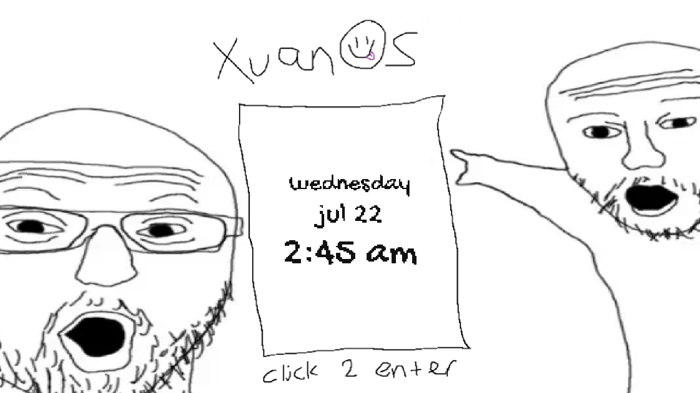
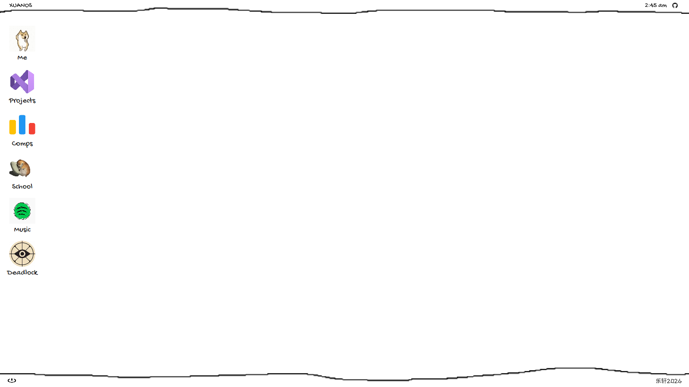
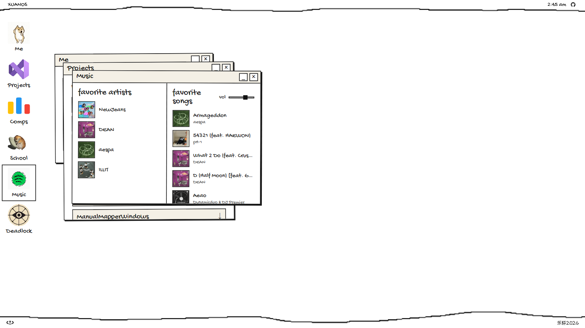
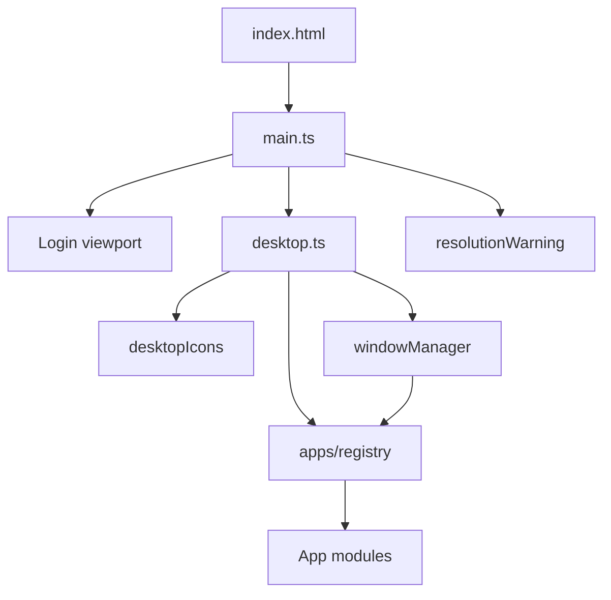
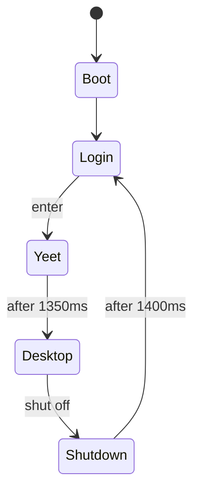

<div align="center">

# XUANOS

**A hand-drawn desktop OS portfolio in the browser.**

[Live site](https://lexuan.vercel.app) · [Documentation](./docs/README.md) · [GitHub](https://github.com/ZhaLuc/xuanOS)

<br />



</div>

---

## About

**XUANOS** is my personal portfolio, built to feel like a tiny operating system instead of a scroll of cards. You click to enter, land on a sketched desktop, open apps in windows, play song previews, and shut the machine off to return to login.

Everything is authored as hand-drawn art with a lean Vite + TypeScript shell on top - no React, no UI kit, no backend.

---

## Screenshots

### Desktop



### Apps open



---

## Table of Contents

- [About](#about)
- [Screenshots](#screenshots)
- [Core Features](#core-features)
- [Design Philosophy](#design-philosophy)
- [Architecture](#architecture)
- [Technology Stack](#technology-stack)
- [Quick Start](#quick-start)
- [Installation](#installation)
- [Configuration](#configuration)
- [Examples](#examples)
- [Project Structure](#project-structure)
- [Execution Flow](#execution-flow)
- [Module Overview](#module-overview)
- [Apps](#apps)
- [Development](#development)
- [Build](#build)
- [Deployment](#deployment)
- [Performance](#performance)
- [Troubleshooting](#troubleshooting)
- [Documentation](#documentation)
- [Contributing](#contributing)

---

## Core Features

- **Login stage** with a live weekday / date / time in the drawn clock box.
- **Desktop shell** with XUANOS brand, live clock, GitHub link, signature `乐轩2026`, and power - shut off.
- **Draggable icons** on a 120x120 grid (click opens, drag moves).
- **Window manager**: focus, titlebar drag, minimize, close; optional content `destroy()` so Music stops audio on close.
- **Six apps**: Me, Projects, Comps, School, Music, Deadlock.
- **Resolution warning** below 1280x720.
- **Favicon**: rainbow flower (`public/favicon.png`).

### Non-goals

No backend, accounts, window resize, automated test suite, or persistence of icon/window state.

---

## Design Philosophy

Hand-drawn art is the UI. Code overlays clocks, labels, and controls onto PNGs rather than replacing them with generic layouts. Typography uses Gochi Hand / ZCOOL KuaiLe with optional ink-crushing so text matches chunky pixels. Motion is rare but characterful (login yeet, shutdown collapse).

Deep dive: [docs/design-philosophy.md](./docs/design-philosophy.md)

---

## Architecture



- **`main.ts`** owns boot, login, yeet, and the shared clock loop.
- **`desktop.ts`** owns chrome, power/shutdown, and composition of icons + WM.
- **`apps/*`** own content only; the WM owns chrome and teardown.

Full diagrams: [docs/architecture.md](./docs/architecture.md)

---

## Technology Stack

| Layer | Choice |
| --- | --- |
| Bundler | Vite 8 |
| Language | TypeScript ~6 |
| UI | Vanilla DOM |
| Styles | `src/style.css` |
| Fonts | Google Fonts (Gochi Hand, ZCOOL KuaiLe) |
| Runtime npm deps | None |

---

## Quick Start

```bash
git clone https://github.com/ZhaLuc/xuanOS.git
cd pf
npm install
npm run dev
```

Open the printed local URL, click the login screen, explore apps, then shut off from the bottom-left power menu.

Live demo: [https://lexuan.vercel.app](https://lexuan.vercel.app)

---

## Installation

See [docs/installation.md](./docs/installation.md) for prerequisites, build, preview, and static deploy notes.

```bash
npm install
npm run dev
npm run build
npm run preview
```

---

## Configuration

There is no `.env`. Behavior is controlled by:

- `package.json` scripts
- `tsconfig.json` (typecheck for `src/`)
- `index.html` (fonts, favicon, title)
- In-code constants (design size 1920x1080, yeet/shutdown timings, grid size, resolution thresholds)

Details: [docs/configuration.md](./docs/configuration.md)

---

## Examples

### Open an app from the desktop

Click an icon without dragging. The window manager creates chrome and calls `createContent()`.

### Play a song preview

Open **Music**, hover a song cover, press play. Adjust **vol**. Close the window (or shut off) to stop audio.

### Return to login

Power - **shut off** - wait for the shutdown animation - login is focused again.

### Add a project entry

Edit the `projects` array in `src/apps/projects.ts` and rebuild/refresh.

---

## Project Structure

```text
pf/
├── index.html
├── package.json
├── tsconfig.json
├── vercel.json
├── public/
├── src/
│   ├── main.ts
│   ├── style.css
│   ├── clock.ts
│   ├── pixelText.ts
│   ├── pixelClock.ts
│   ├── desktop.ts
│   ├── desktopIcons.ts
│   ├── resolutionWarning.ts
│   ├── wm/windowManager.ts
│   └── apps/
└── docs/
```

Asset inventory: [docs/assets.md](./docs/assets.md)

---

## Execution Flow



- [Boot and login](./docs/workflows/boot-and-login.md)
- [Desktop session](./docs/workflows/desktop-session.md)
- [Shutdown](./docs/workflows/shutdown.md)
- [App lifecycle](./docs/workflows/app-lifecycle.md)

---

## Module Overview

| Module | Doc |
| --- | --- |
| `main.ts` | [docs/modules/main.md](./docs/modules/main.md) |
| `clock.ts` | [docs/modules/clock.md](./docs/modules/clock.md) |
| `pixelText.ts` | [docs/modules/pixel-text.md](./docs/modules/pixel-text.md) |
| `pixelClock.ts` | [docs/modules/pixel-clock.md](./docs/modules/pixel-clock.md) |
| `desktop.ts` | [docs/modules/desktop.md](./docs/modules/desktop.md) |
| `desktopIcons.ts` | [docs/modules/desktop-icons.md](./docs/modules/desktop-icons.md) |
| `windowManager.ts` | [docs/modules/window-manager.md](./docs/modules/window-manager.md) |
| `resolutionWarning.ts` | [docs/modules/resolution-warning.md](./docs/modules/resolution-warning.md) |
| `style.css` | [docs/modules/style.md](./docs/modules/style.md) |

---

## Apps

| App | Doc |
| --- | --- |
| Overview / contract | [docs/apps/overview.md](./docs/apps/overview.md) |
| Registry | [docs/apps/registry.md](./docs/apps/registry.md) |
| Me | [docs/apps/me.md](./docs/apps/me.md) |
| Projects | [docs/apps/projects.md](./docs/apps/projects.md) |
| Comps | [docs/apps/comps.md](./docs/apps/comps.md) |
| School | [docs/apps/school.md](./docs/apps/school.md) |
| Music | [docs/apps/music.md](./docs/apps/music.md) |
| Deadlock | [docs/apps/deadlock.md](./docs/apps/deadlock.md) |

---

## Development

1. Branch from `main`.
2. `npm run dev` while editing.
3. Keep changes aligned with the hand-drawn aesthetic and lean stack.
4. Update `/docs` when behavior changes.
5. `npm run build` before opening a PR.

Guide: [docs/development.md](./docs/development.md)

There is no automated unit/e2e suite. Use the manual smoke checklist in the development guide (login, apps, music cleanup, shutdown, resize warning, production build).

---

## Build

`npm run build` runs:

1. **`tsc`** - typecheck `src/` (`noEmit: true`).
2. **`vite build`** - emit static assets to `dist/` (HTML/JS/CSS + copied `public/`).

---

## Deployment

Production: [https://lexuan.vercel.app](https://lexuan.vercel.app)

`vercel.json` configures Vite builds to `dist/` with an SPA rewrite. You can also host `dist/` on any static file host. Ensure asset paths like `/loader.png` resolve and outbound access to Google Fonts (and Apple's preview CDN for Music) is allowed.

Details: [docs/deployment.md](./docs/deployment.md)

---

## Performance

JS/CSS are small; PNG/JPEG stage and music art dominate weight. Clock redraws are cheap; avoid large crushed canvases and keep `preload="none"` for audio. Details: [docs/performance.md](./docs/performance.md)

---

## Troubleshooting

Common issues (blank enter transition, drag scaling, music autoplay, minimized windows): [docs/troubleshooting.md](./docs/troubleshooting.md) and [docs/faq.md](./docs/faq.md)

---

## Documentation

The full technical suite lives under **[`docs/`](./docs/README.md)** - architecture, modules, apps, workflows, contributing, glossary, and more.

---

## Contributing

See [docs/contributing.md](./docs/contributing.md).
