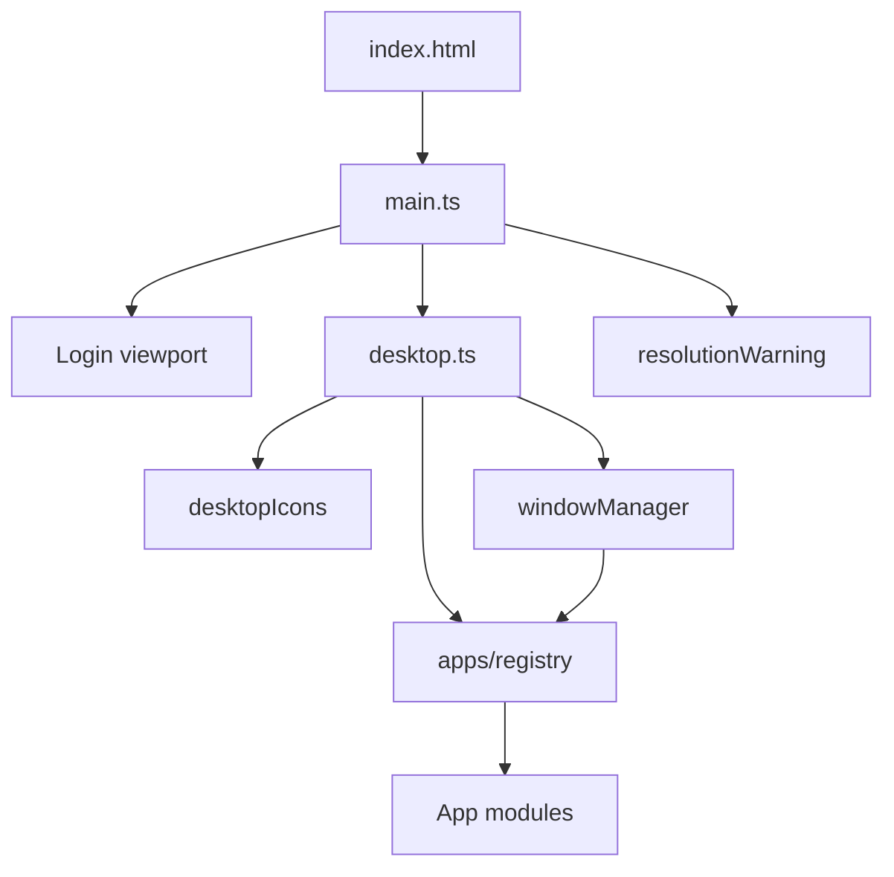
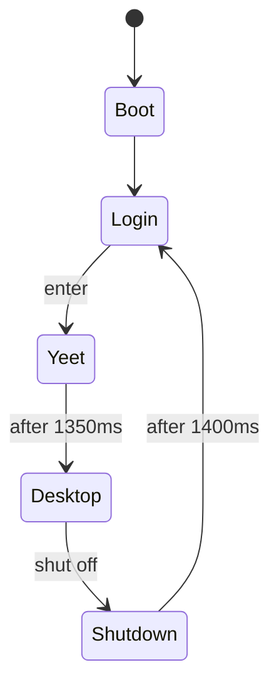

# XUANOS

**XUANOS** is a personal portfolio that behaves like a tiny hand-drawn desktop operating system in the browser. You log in, land on a sketched desktop, open apps in windows, play music previews, and shut the machine off to return to the login screen.

Repository: [https://github.com/LucasZhang3/pf](https://github.com/LucasZhang3/pf)

---

## Table of Contents

- [Overview](#overview)
- [Purpose](#purpose)
- [Core Features](#core-features)
- [Design Philosophy](#design-philosophy)
- [High-Level Architecture](#high-level-architecture)
- [Technology Stack](#technology-stack)
- [Quick Start](#quick-start)
- [Installation](#installation)
- [Configuration](#configuration)
- [Examples](#examples)
- [Project Structure](#project-structure)
- [Internal Architecture](#internal-architecture)
- [Execution Flow](#execution-flow)
- [Module Overview](#module-overview)
- [Apps](#apps)
- [Development Workflow](#development-workflow)
- [Testing](#testing)
- [Build Process](#build-process)
- [Deployment](#deployment)
- [Security Considerations](#security-considerations)
- [Performance Considerations](#performance-considerations)
- [Troubleshooting](#troubleshooting)
- [Documentation Index](#documentation-index)
- [Contributing](#contributing)
- [Roadmap](#roadmap)
- [License](#license)

---

## Overview

Most portfolios are scrolls of cards. XUANOS is an **interactive OS shell**:

1. A full-bleed login drawing with a live pixelated clock.
2. A yeet transition into the desktop.
3. Icons, draggable windows, a power button, and themed apps (Me, Projects, Comps, School, Music, Deadlock).

It is intentionally imperfect — chunky art, casual copy, and a lean Vite + TypeScript codebase with **no UI framework**.

---

## Purpose

| Goal | Approach |
| --- | --- |
| Introduce Lucas | Me / School / Comps / Projects apps |
| Show taste and personality | Music, Deadlock, hand-drawn chrome |
| Stay memorable | OS metaphor + yeet + bad shutdown |
| Stay fast | Vanilla DOM, tiny JS, static hosting |

---

## Core Features

- **Login stage** with live weekday / date / time in the drawn box.
- **Desktop shell** with XUANOS brand, live clock, GitHub link, signature `乐轩2026`, and power → shut off.
- **Draggable icons** on a 120×120 grid (click opens, drag moves).
- **Window manager**: focus, titlebar drag, minimize, close; optional content `destroy()` (Music stops audio).
- **Six apps** covering bio, projects, competitions, school, music previews, and Deadlock slides.
- **Resolution warning** below 1280×720.
- **Favicon** rainbow flower (`public/favicon.png`).

### Key capabilities

- Stretch-to-fill 1920×1080 design canvas (independent X/Y scale).
- Pixel canvas text helpers for login clock and menubar labels.
- iTunes preview playback with volume control and cleanup on close/shutdown.

### Explicit non-goals

No backend, accounts, real OS scheduling, window resize, automated test suite, or persistence of icon/window state.

---

## Design Philosophy

Hand-drawn art is the UI. Code overlays clocks, labels, and controls onto PNGs rather than replacing them with generic layouts. Typography prefers Gochi Hand / ZCOOL KuaiLe and optional ink-crushing so text matches chunky pixels. Motion is rare but characterful (login yeet, shutdown collapse).

Deep dive: [docs/design-philosophy.md](./docs/design-philosophy.md)

---

## High-Level Architecture



- **`main.ts`** owns boot, login, yeet, and the shared clock loop.
- **`desktop.ts`** owns chrome, power/shutdown, and composition of icons + WM.
- **`apps/*`** own content only; the WM owns chrome and teardown.

Full diagrams: [docs/architecture.md](./docs/architecture.md)

---

## Technology Stack

| Layer | Choice |
| --- | --- |
| Bundler | Vite 8 |
| Language | TypeScript ~6 |
| UI | Vanilla DOM |
| Styles | `src/style.css` |
| Fonts | Google Fonts (Gochi Hand, ZCOOL KuaiLe) |
| Runtime npm deps | None |

---

## Quick Start

```bash
git clone https://github.com/LucasZhang3/pf.git
cd pf
npm install
npm run dev
```

Open the printed local URL → click the login screen → explore apps → shut off from the bottom-left power menu.

---

## Installation

See [docs/installation.md](./docs/installation.md) for prerequisites, build, preview, and static deploy notes.

Summary:

```bash
npm install          # tooling only
npm run dev          # development
npm run build        # tsc && vite build → dist/
npm run preview      # serve dist/
```

---

## Configuration

There is no `.env`. Behavior is controlled by:

- `package.json` scripts
- `tsconfig.json` (typecheck for `src/`)
- `index.html` (fonts, favicon, title)
- In-code constants (design size 1920×1080, yeet/shutdown timings, grid size, resolution thresholds)

Details: [docs/configuration.md](./docs/configuration.md)

---

## Examples

### Open an app from the desktop

Click an icon without dragging. The window manager creates chrome and calls `createContent()`.

### Play a song preview

Open **Music** → hover a song cover → play. Adjust **vol**. Close the window (or shut off) to stop audio.

### Return to login

Power → **shut off** → wait for the shutdown animation → login is focused again.

### Add a project entry

Edit the `projects` array in `src/apps/projects.ts` and rebuild/refresh.

---

## Project Structure

```text
pf/
├── index.html
├── package.json
├── tsconfig.json
├── public/                 # Static assets (/favicon.png, art, icons, music/)
├── src/
│   ├── main.ts             # Boot + login
│   ├── style.css
│   ├── clock.ts
│   ├── pixelText.ts
│   ├── pixelClock.ts
│   ├── desktop.ts
│   ├── desktopIcons.ts
│   ├── resolutionWarning.ts
│   ├── wm/windowManager.ts
│   └── apps/               # App definitions + registry
└── docs/                   # Full technical documentation
```

Asset inventory: [docs/assets.md](./docs/assets.md)

---

## Internal Architecture

| Abstraction | Role |
| --- | --- |
| `AppDefinition` | App metadata + `createContent` |
| `DesktopController` | `show` / `hide` / `fit` / `tick` |
| `WindowManager` | Window lifecycle + drag/focus |
| `ScaleProvider` | Live `{ x, y }` for pointer math |
| Optional `destroy()` | Content cleanup on close |

Apps never import the window manager. The manager never hard-codes app UI.

---

## Execution Flow



Workflow docs:

- [Boot and login](./docs/workflows/boot-and-login.md)
- [Desktop session](./docs/workflows/desktop-session.md)
- [Shutdown](./docs/workflows/shutdown.md)
- [App lifecycle](./docs/workflows/app-lifecycle.md)

---

## Module Overview

| Module | Doc |
| --- | --- |
| `main.ts` | [docs/modules/main.md](./docs/modules/main.md) |
| `clock.ts` | [docs/modules/clock.md](./docs/modules/clock.md) |
| `pixelText.ts` | [docs/modules/pixel-text.md](./docs/modules/pixel-text.md) |
| `pixelClock.ts` | [docs/modules/pixel-clock.md](./docs/modules/pixel-clock.md) |
| `desktop.ts` | [docs/modules/desktop.md](./docs/modules/desktop.md) |
| `desktopIcons.ts` | [docs/modules/desktop-icons.md](./docs/modules/desktop-icons.md) |
| `windowManager.ts` | [docs/modules/window-manager.md](./docs/modules/window-manager.md) |
| `resolutionWarning.ts` | [docs/modules/resolution-warning.md](./docs/modules/resolution-warning.md) |
| `style.css` | [docs/modules/style.md](./docs/modules/style.md) |

---

## Apps

| App | Doc |
| --- | --- |
| Overview / contract | [docs/apps/overview.md](./docs/apps/overview.md) |
| Registry | [docs/apps/registry.md](./docs/apps/registry.md) |
| Me | [docs/apps/me.md](./docs/apps/me.md) |
| Projects | [docs/apps/projects.md](./docs/apps/projects.md) |
| Comps | [docs/apps/comps.md](./docs/apps/comps.md) |
| School | [docs/apps/school.md](./docs/apps/school.md) |
| Music | [docs/apps/music.md](./docs/apps/music.md) |
| Deadlock | [docs/apps/deadlock.md](./docs/apps/deadlock.md) |

---

## Development Workflow

1. Branch from `main`.
2. `npm run dev` while editing.
3. Keep changes aligned with the hand-drawn aesthetic and lean stack.
4. Update `/docs` when behavior changes.
5. `npm run build` before opening a PR.

Guide: [docs/development.md](./docs/development.md)

---

## Testing

No automated unit/e2e suite is checked in. Use the manual smoke checklist in [docs/development.md](./docs/development.md) (login, apps, music cleanup, shutdown, resize warning, production build).

---

## Build Process

`npm run build` runs:

1. **`tsc`** — typecheck `src/` (`noEmit: true`).
2. **`vite build`** — emit static assets to `dist/` (HTML/JS/CSS + copied `public/`).

---

## Deployment

Production: [https://lexuan.vercel.app](https://lexuan.vercel.app)

`vercel.json` configures Vite builds to `dist/` with an SPA rewrite. You can also host `dist/` on any static file host. Ensure asset paths like `/loader.png` resolve and outbound access to Google Fonts (and Apple’s preview CDN for Music) is allowed.

Details: [docs/deployment.md](./docs/deployment.md)

---

## Security Considerations

Static site threat model: treat third-party fonts and iTunes previews as external trust; use `noopener noreferrer` on external tabs; no secrets in the client. Details: [docs/security.md](./docs/security.md)

---

## Performance Considerations

JS/CSS are small; PNG/JPEG stage and music art dominate weight. Clock redraws are cheap; avoid large crushed canvases and keep `preload="none"` for audio. Details: [docs/performance.md](./docs/performance.md)

---

## Troubleshooting

Common issues (blank enter transition, drag scaling, music autoplay, minimized windows): [docs/troubleshooting.md](./docs/troubleshooting.md) and [docs/faq.md](./docs/faq.md)

---

## Documentation Index

The complete technical suite lives under **[`docs/`](./docs/README.md)** — architecture, modules, apps, workflows, contributing, glossary, and more.

---

## Contributing

See [docs/contributing.md](./docs/contributing.md). Keep commits attributed to the repository owner without Cursor co-author trailers.

---

## Roadmap

Informal / aspirational (not scheduled):

- Persist icon positions (optional).
- Taskbar or dock for minimized windows.
- Automated smoke tests.
- Further apps or richer Projects presentation.
- Optional reduced-motion path for yeet/shutdown.

---

## License

No `LICENSE` file is currently published in this repository. Treat the source as owned by the repository owner unless a license is added later. If you need explicit licensing terms, ask the maintainer or add a license file in a follow-up change.
