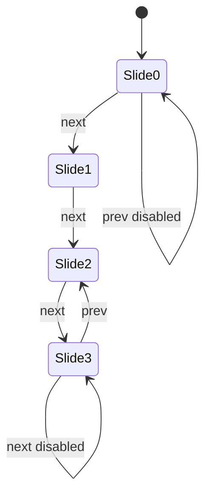

# App: Deadlock

**Path:** `src/apps/deadlock.ts`  
**ID:** `deadlock`  
**Window:** 520×460, title `Deadlock`  
**Icon:** `/deadlock-icon.png` · label `Deadlock`

---

## Purpose

Small slide deck about Deadlock characters plus a personal rank / Statlocker slide.

---

## Slide Model

```ts
type CharacterSlide = {
  kind: "character";
  name: string;
  portrait: string;
  alt: string;
  paragraphs: string[];
};

type StatsSlide = {
  kind: "stats";
  name: string;
  rankSrc: string;
  profileUrl: string;
  profileLabel: string;
};
```

| Index | Kind | Content |
| --- | --- | --- |
| 0 | character | Seven — `/seven.png` |
| 1 | character | Wraith — `/wraith.png` |
| 2 | character | Billy — `/billy.png` |
| 3 | stats | Rank image `/deadlock-rank.png` + link to Statlocker profile |

---

## Navigation



- Pager text: `{index+1} / {slides.length}` (e.g. `1 / 4`).
- Prev disabled on first; next disabled on last.
- Stats slide uses `.app-deadlock__slide--stats` and outbound link with `noopener noreferrer`.

---

## Registration

| Field | Value |
| --- | --- |
| `id` | `deadlock` |
| `width` / `height` | 520 × 460 |

No `destroy` hook (no media timers).

---

## Related Documents

- [Apps Overview](./overview.md)
- [Assets](../assets.md)
