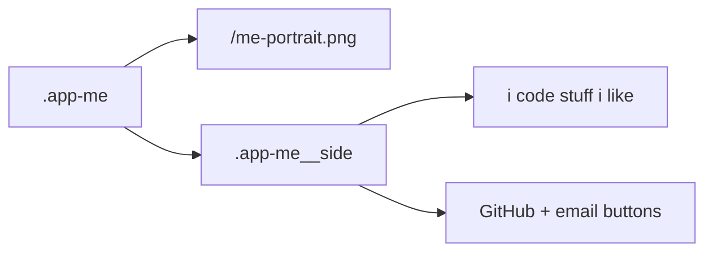

# App: Me

**Path:** `src/apps/me.ts`  
**ID:** `me`  
**Window:** 520×360, title `Me`  
**Icon:** `/me-icon.png` · label `Me`

---

## Purpose

Personal intro card: portrait, short quote, and outbound contact actions. First icon in `appOrder`.

---

## Content Structure



| Element | Detail |
| --- | --- |
| Portrait | `/me-portrait.png`, markup width/height 180×240, `alt="me"` |
| Quote | `i code stuff i like` |
| GitHub | `https://github.com/LucasZhang3`, `target="_blank"`, `rel="noopener noreferrer"` |
| Email | `mailto:lucaszhangbusiness@gmail.com` |
| Icons | Inline SVG (GitHub mark + envelope) |

---

## Registration

```ts
export const meApp: AppDefinition = {
  id: "me",
  title: "Me",
  iconSrc: "/me-icon.png",
  iconLabel: "Me",
  width: 520,
  height: 360,
  createContent: createMeContent,
};
```

---

## Lifecycle

Stateless DOM. No timers, audio, or `destroy` hook. Closing the window discards the nodes; reopening rebuilds via `createContent()`.

---

## Styling

Classes under `.app-me` in `src/style.css` (portrait + side column layout).

---

## Related Documents

- [Apps Overview](./overview.md)
- [Registry](./registry.md)
- [Assets](../assets.md)
