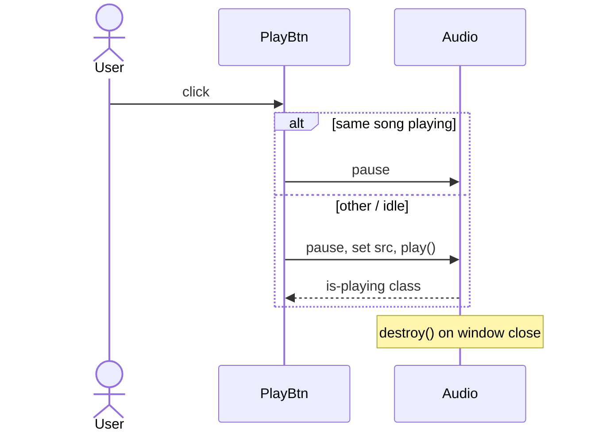

# App: Music

**Path:** `src/apps/music.ts`  
**ID:** `music`  
**Window:** 620×440, title `Music`  
**Icon:** `/music-icon.png` · label `Music`

---

## Purpose

Two-pane player: favorite artists (display only) and favorite songs with iTunes AAC preview playback and a volume slider.

---

## Data

### Artists

| Name | Image |
| --- | --- |
| NewJeans | `/music/artist-newjeans.jpg` |
| DEAN | `/music/artist-dean.jpg` |
| aespa | `/music/artist-aespa.jpg` |
| ILLIT | `/music/artist-illit.jpg` |

### Songs

Each song has `title`, `artist`, local cover under `/music/song-*.jpg`, and a remote `preview` URL on `audio-ssl.itunes.apple.com` (Armageddon, 54321, What 2 Do, Half Moon, Aeao).

---

## Playback Behavior



| Detail | Implementation |
| --- | --- |
| Element | `new Audio()`, `preload = "none"` |
| Volume | Range 0–100, default **70**; maps to `audio.volume` |
| Toggle | Clicking the active playing button pauses |
| Errors | `play()` rejection clears playing UI |
| Ended / pause | Clears `.is-playing` (pause handler ignores seek) |

---

## Cleanup (`destroy`)

```ts
musicRoot.destroy = () => {
  audio.pause();
  audio.removeAttribute("src");
  setPlaying(null, false);
};
```

The window manager calls this on close and on shutdown `closeAll()`, so audio does not continue after the Music window or OS session ends.

---

## Registration

| Field | Value |
| --- | --- |
| `id` | `music` |
| `width` / `height` | 620 × 440 |

Root class: `.app-music`.

---

## Related Documents

- [Apps Overview](./overview.md)
- [App Lifecycle](../workflows/app-lifecycle.md)
- [Performance](../performance.md)
- [Assets](../assets.md)
