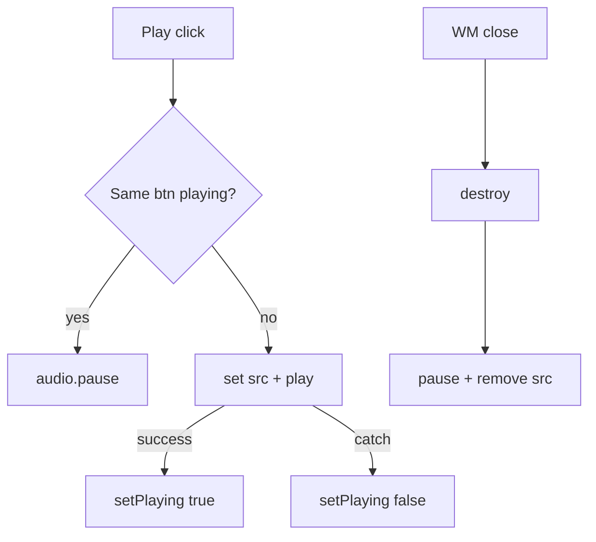

# App: Music

**Path:** `src/apps/music.ts`  
**ID:** `music`  
**Window:** 620×440, title `Music`  
**Icon:** `/music-icon.png`

---

## Purpose

Show favorite artists and songs with artwork; play short official iTunes previews; adjust volume; stop cleanly when the window closes.

---

## Data

### Artists

NewJeans, DEAN, aespa, ILLIT — images under `/music/artist-*.jpg`.

### Songs

| Title | Artist | Preview |
| --- | --- | --- |
| Armageddon | aespa | Apple CDN m4a |
| 54321 (feat. HAEWON) | pH-1 | Apple CDN m4a |
| What 2 Do (…) | DEAN | Apple CDN m4a |
| D (Half Moon) (…) | DEAN | Apple CDN m4a |
| Aeao | Dynamicduo & DJ Premier | Apple CDN m4a |

Covers under `/music/song-*.jpg`.

---

## Playback Architecture

- One shared `Audio` instance per Music window content (`preload = "none"`).
- Default volume 70% via range input.
- Hover/focus/playing shows play button overlay on covers.
- Click playing track pauses; click another switches `src` and plays.
- `ended` / non-seeking `pause` clears `.is-playing` UI.



---

## `destroy()` Hook

Attached on the content root:

```ts
musicRoot.destroy = () => {
  audio.pause();
  audio.removeAttribute("src");
  setPlaying(null, false);
};
```

Called by the window manager on close and by desktop shutdown via `closeAll()`.

**Minimize does not stop audio** — only close/shutdown.

---

## Failure Modes

| Failure | Behavior |
| --- | --- |
| Autoplay blocked | `play()` rejects → UI cleared |
| CDN unreachable | Play fails → UI cleared |
| Preview URL expires | Same as unreachable |

---

## Security / Privacy Notes

- Loads third-party audio from Apple.
- No user audio upload.
- See [Security](../security.md).

---

## Related Documents

- [Window Manager](../modules/window-manager.md)
- [Shutdown workflow](../workflows/shutdown.md)
- [Assets](../assets.md)
