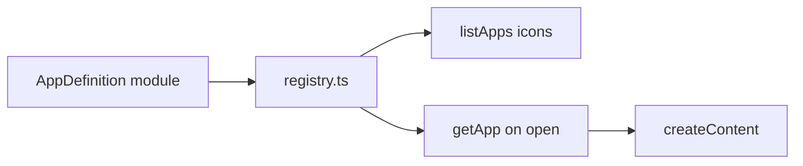

# Apps Overview

## What Is an App?

An app is a registered `AppDefinition` that can appear as a desktop icon and open inside a managed window. Apps are pure client modules under `src/apps/`.

---

## Contract

```ts
export type AppDefinition = {
  id: AppId;
  title: string;      // Window titlebar text
  iconSrc: string;    // Desktop icon image URL
  iconLabel: string;  // Label under icon
  width: number;      // Window width (design px)
  height: number;     // Window height (design px)
  createContent: () => HTMLElement;
};
```

### Optional extension

Content roots may define `destroy?: () => void` for cleanup (Music). The window manager invokes it on close.

---

## App Order

Defined in `types.ts` as `appOrder` and used by `listApps()` for icon stacking:

1. Me  
2. Projects  
3. Comps (`programming-comps`)  
4. School  
5. Music  
6. Deadlock  

---

## How Apps Plug In



To add an app:

1. Create `src/apps/myApp.ts` exporting `AppDefinition`.
2. Extend `AppId` and `appOrder` in `types.ts`.
3. Register in `registry.ts`.
4. Add icon asset under `public/`.
5. Add styles in `style.css`.
6. Document under `docs/apps/`.

---

## App Catalog

| Doc | ID | Size | Notes |
| --- | --- | --- | --- |
| [me.md](./me.md) | `me` | 520×360 | Portrait + contact |
| [projects.md](./projects.md) | `projects` | 560×520 | Accordion list |
| [comps.md](./comps.md) | `programming-comps` | 480×420 | Static lists |
| [school.md](./school.md) | `school` | 520×480 | Collapsible lists |
| [music.md](./music.md) | `music` | 620×440 | Audio + destroy |
| [deadlock.md](./deadlock.md) | `deadlock` | 520×460 | Slides |

---

## Shared Assumptions

- Apps do not import the window manager.
- Apps should not assume they stay mounted forever - Music demonstrates cleanup.
- External links use `target="_blank"` and `rel="noopener noreferrer"` where applicable.
- Copy tone matches the hand-drawn OS (casual, lowercase headings often).

---

## Related Documents

- [Registry](./registry.md)
- [Window Manager](../modules/window-manager.md)
- [App Lifecycle](../workflows/app-lifecycle.md)
