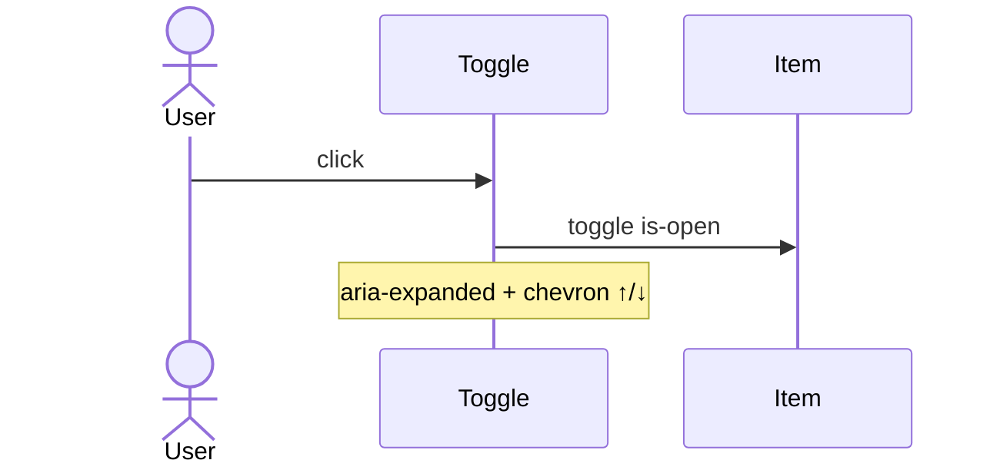

# App: Projects

**Path:** `src/apps/projects.ts`  
**ID:** `projects`  
**Window:** 560×520, title `Projects`  
**Icon:** `/projects-icon.png` · label `Projects`

---

## Purpose

Scrollable accordion of portfolio projects. Each row expands to a blurb and GitHub link.

---

## Data Model

```ts
type Project = {
  name: string;
  blurb: string;
  url: string;
};
```

Projects are a **hardcoded array** in `projects.ts` (GenesisOS, mycc, GridMark, RayTracing, NURC, WebRadarDL, ManualMapperWindows, AZSEF water analysis, BMECS EPICS, SaveEditorTBC, AstroBeeQuest, Codeforces, USACO, Arch Linux Webpage, …). Edit that array to change content - there is no CMS or API.

---

## Interaction



- Closed by default (`aria-expanded="false"`, chevron `↓`).
- Multiple items may be open at once (independent toggles).
- Links use `target="_blank"` and `rel="noopener noreferrer"`.

---

## Registration

| Field | Value |
| --- | --- |
| `id` | `projects` |
| `width` / `height` | 560 × 520 |
| `createContent` | Builds title + list of toggle/panel pairs |

No `destroy` hook.

---

## Related Documents

- [Apps Overview](./overview.md)
