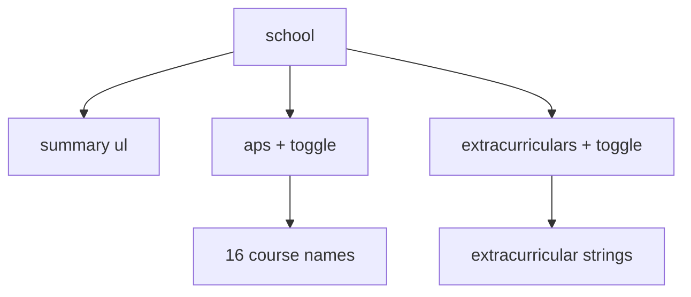

# App: School

**Path:** `src/apps/school.ts`  
**ID:** `school`  
**Window:** 520×480, title `School`  
**Icon:** `/school-icon.png` · label `School`

---

## Purpose

Academic snapshot: summary stats, collapsible AP list, collapsible extracurriculars.

---

## Summary (always visible)

- 16x APs
- all 5s, couple 4s
- gpa 3.91 UW / 4.71 W

---

## Collapsible Sections

`bindToggle()` keeps panel `.is-open`, `aria-expanded`, and button label (`show … ↓` / `hide … ↑`) in sync. Both sections start **closed**.

AP courses and extracurricular strings live in `apCourses` and `extracurriculars` arrays in source - edit those arrays to update the portfolio.

---

## Registration

| Field | Value |
| --- | --- |
| `id` | `school` |
| `width` / `height` | 520 × 480 |

Root class: `.app-school`. No `destroy` hook.

---

## Related Documents

- [Apps Overview](./overview.md)
- [Comps](./comps.md)
