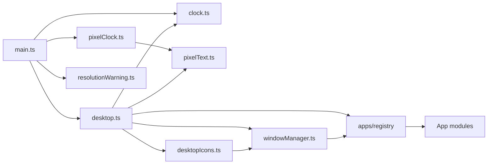
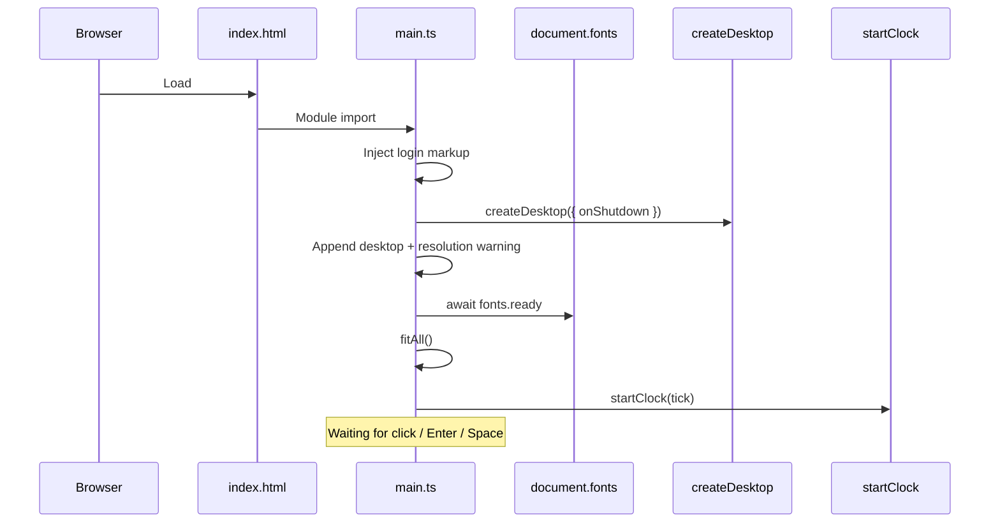
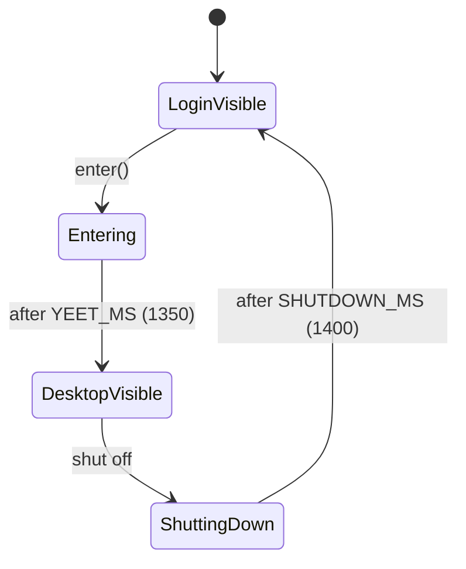
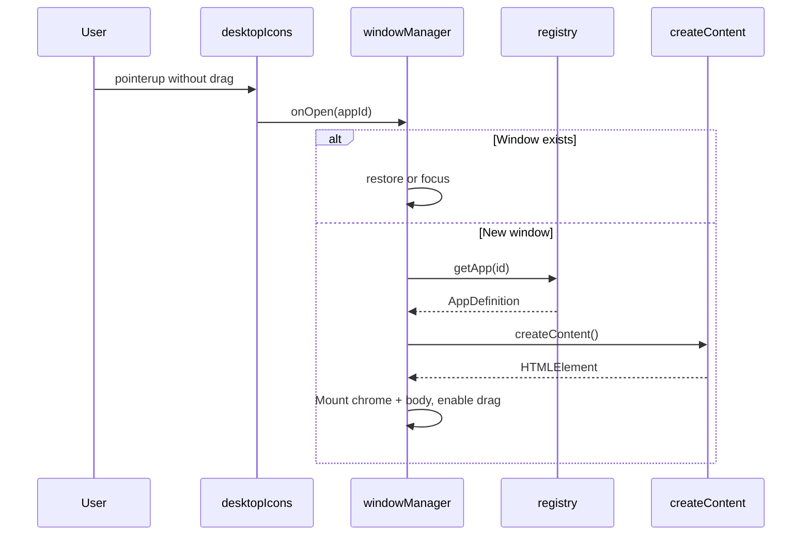
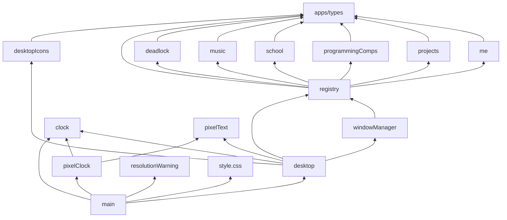

# Architecture

This document describes how XUANOS is structured, how control and data move through the system, and what each major layer owns.

---

## Table of Contents

1. [Architectural Style](#architectural-style)
2. [Directory Organization](#directory-organization)
3. [Component Relationships](#component-relationships)
4. [Startup Sequence](#startup-sequence)
5. [Runtime Control Flow](#runtime-control-flow)
6. [Shutdown Sequence](#shutdown-sequence)
7. [Dependency Graph](#dependency-graph)
8. [Design Patterns](#design-patterns)
9. [Internal Abstractions](#internal-abstractions)
10. [Assumptions and Boundaries](#assumptions-and-boundaries)

---

## Architectural Style

XUANOS is a **single-page client application** with:

- **No framework** — modules create and mutate DOM nodes directly.
- **Factory controllers** — `createDesktop`, `createWindowManager`, `createPixelLabel`, etc. return objects with methods rather than classes.
- **Registry-based apps** — each app is an `AppDefinition`; the window manager does not know app internals.
- **Fixed design stage** — visual layout is authored at 1920×1080 and scaled to the viewport.

There is no Flux/Redux store, no router, and no server. Application state lives in closures (window map, icon positions, music `Audio` instance, `entered` / `visible` flags).

---

## Directory Organization

```text
Portfolio/
├── index.html              # Shell: fonts, favicon, #app mount
├── package.json            # Scripts + Vite/TS tooling
├── tsconfig.json           # Strict-ish TypeScript for src/
├── public/                 # Static assets served at /
│   ├── favicon.png
│   ├── loader.png          # Login artwork
│   ├── desktop.png         # Desktop artwork
│   ├── *-icon.png          # Desktop icons
│   ├── music/              # Artist/song artwork
│   └── …                   # Me/Deadlock portraits, power, etc.
├── src/
│   ├── main.ts             # Boot + login orchestration
│   ├── style.css           # All styles
│   ├── clock.ts            # Time formatting + interval
│   ├── pixelText.ts        # Generic pixel labels
│   ├── pixelClock.ts       # Login clock canvas
│   ├── desktop.ts          # Desktop shell
│   ├── desktopIcons.ts     # Icon drag/open
│   ├── resolutionWarning.ts
│   ├── wm/
│   │   └── windowManager.ts
│   └── apps/
│       ├── types.ts
│       ├── registry.ts
│       ├── me.ts
│       ├── projects.ts
│       ├── programmingComps.ts
│       ├── school.ts
│       ├── music.ts
│       └── deadlock.ts
└── docs/                   # This documentation suite
```

---

## Component Relationships



### Ownership

| Component | Owns | Does not own |
| --- | --- | --- |
| `main.ts` | Login DOM, enter animation, global clock loop, wiring shutdown → login | App content, window chrome internals |
| `desktop.ts` | Menubar, power menu, icon mount, scale factors, visibility | Per-app markup |
| `desktopIcons.ts` | Icon positions, drag vs click discrimination | Window creation details (calls `onOpen`) |
| `windowManager.ts` | Window records, z-order, drag, minimize/close, `destroy` hook | Icon layout |
| `apps/*` | Content DOM and app-local state | Window chrome |
| `style.css` | All presentation and keyframe animations | Business logic |

---

## Startup Sequence



**When:** Immediately on page load.

**Assumptions:** `#app` exists; 2D canvas is available; Google Fonts eventually load (boot still proceeds after `fonts.ready`).

**Failure modes:** Missing `#app` throws. Missing 2D canvas context throws inside pixel helpers when first drawn.

---

## Runtime Control Flow

### Enter desktop



### Open an app



### Scale-aware pointer math

Both icon and window dragging convert screen deltas to design-space coordinates:

```text
dx_design = (clientX - originX) / scaleX
dy_design = (clientY - originY) / scaleY
```

`scaleX` / `scaleY` come from `window.innerWidth / 1920` and `window.innerHeight / 1080`, updated on resize and on desktop `show()`.

---

## Shutdown Sequence

Triggered by bottom-left power → **shut off**:

1. Guard with `shuttingDown` so double-clicks do not stack timers.
2. Close power menu; add `is-shutting-off` (CSS `bad-shutdown` animation).
3. After 1400 ms:
   - `wm.closeAll()` — runs optional content `destroy()` (stops Music audio).
   - `hide()` desktop.
   - Clear shutdown class/flags.
   - Call `onShutdown()` from `main.ts`, which restores login focus and clears `entered`.

See [Shutdown Workflow](./workflows/shutdown.md).

---

## Dependency Graph



---

## Design Patterns

| Pattern | Where | Purpose |
| --- | --- | --- |
| Factory function | `createDesktop`, `createWindowManager`, `createPixelLabel`, apps' `createContent` | Encapsulate private state in closures |
| Registry | `apps/registry.ts` | Decouple WM from concrete apps |
| Optional cleanup hook | `HTMLElement & { destroy?: () => void }` on Music | Allow resource teardown without expanding `AppDefinition` |
| Scale provider callback | `() => ({ x, y })` | Drag code always reads latest scale |
| Class toggles over `[hidden]` | `.is-away`, `.is-open`, `.is-active` | Avoid CSS `display: flex` overriding `[hidden]` |

### Historical edge case: `[hidden]` vs `display`

Early bugs occurred because `.viewport { display: flex }` overrode the HTML `hidden` attribute. The project now prefers classes such as `.is-away { display: none !important }` for login dismissal and `.is-open` for expandable panels.

---

## Internal Abstractions

### `AppDefinition`

```ts
export type AppDefinition = {
  id: AppId;
  title: string;
  iconSrc: string;
  iconLabel: string;
  width: number;
  height: number;
  createContent: () => HTMLElement;
};
```

Contract: `createContent` returns a root element that the WM appends under `[data-body]`. Optionally attach `destroy()` for cleanup when the window closes.

### `DesktopController`

```ts
export type DesktopController = {
  root: HTMLElement;
  show: () => void;
  hide: () => void;
  fit: () => void;
  tick: (now: Date) => void;
};
```

### `WindowManager`

```ts
export type WindowManager = {
  open: (id: AppId) => void;
  close: (id: AppId) => void;
  closeAll: () => void;
  minimize: (id: AppId) => void;
  restore: (id: AppId) => void;
  focus: (id: AppId) => void;
};
```

One window per `AppId` at a time. Re-opening focuses or restores.

### `ScaleProvider`

```ts
export type ScaleProvider = () => { x: number; y: number };
```

Shared conceptual type in both `desktopIcons.ts` and `windowManager.ts` (duplicated type alias, same shape).

---

## Assumptions and Boundaries

| Assumption | Implication |
| --- | --- |
| Design art is exactly 1920×1080 | Stage CSS and `DESIGN_*` constants match PNGs |
| Apps are static content | No lazy remote app loading |
| Single Music audio element per Music window instance | Closing stops that instance; minimize does not |
| Left-click only for icons | `pointerdown` ignores non-button-0 |
| No persistence | Reload resets icons and open windows |

---

## Related Documents

- [System Overview](./system-overview.md)
- [Scaling and Viewport](./scaling-and-viewport.md)
- [Module: main](./modules/main.md)
- [Module: window manager](./modules/window-manager.md)
- [Workflow: app lifecycle](./workflows/app-lifecycle.md)
