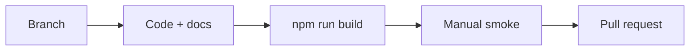

# Contributing

## Welcome

Contributions that improve the hand-drawn OS portfolio — apps, polish, accessibility, docs — are welcome.

---

## Process

1. Fork or branch from `main`.
2. Keep changes focused (one concern per PR when possible).
3. Run `npm run build`.
4. Manually smoke-test login, desktop, affected apps, shutdown (see [Development](./development.md)).
5. Update `/docs` when behavior or architecture changes.
6. Open a PR with a short summary and test plan.

---

## Authorship

Commits for this project are attributed to the repository owner (**Lucas** / `lucaszhang1118@gmail.com`). Do not add Cursor or other AI co-author trailers to commits.

---

## Code Expectations

- Match existing style and stack (no unnecessary frameworks).
- Preserve the imperfect, drawn aesthetic — see [Design Philosophy](./design-philosophy.md).
- Avoid drive-by refactors unrelated to the PR goal.
- Do not commit secrets, `.env` files, or large unrelated binaries.
- Prefer absolute root asset paths (`/icon.png`) for `public/` files.

---

## Docs

When adding modules/apps/workflows, add a focused page under `docs/` and link it from [`docs/README.md`](./README.md). Prefer Mermaid for control-flow diagrams. Base claims on the codebase — do not invent tests, CLI tools, or backends.

---

## Related Documents

- [Development](./development.md)
- [Design Philosophy](./design-philosophy.md)
- [FAQ](./faq.md)
