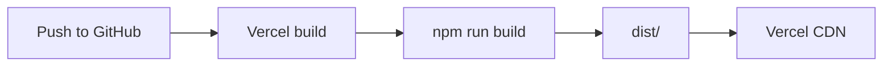

# Deployment

## Production URL

Live site: [https://lexuan.vercel.app](https://lexuan.vercel.app)  
Source: [https://github.com/LucasZhang3/pf](https://github.com/LucasZhang3/pf)

---

## What Gets Deployed

`npm run build` produces a static site in `dist/`:

- `index.html`
- Hashed JS/CSS under `dist/assets/`
- Everything from `public/` at the site root (`/favicon.png`, `/loader.png`, …)

There is no server-side runtime beyond the static host.

---

## Vercel Configuration

File: `vercel.json` (repo root)

```json
{
  "$schema": "https://openapi.vercel.sh/vercel.json",
  "framework": "vite",
  "buildCommand": "npm run build",
  "outputDirectory": "dist",
  "rewrites": [{ "source": "/(.*)", "destination": "/index.html" }]
}
```

| Field | Role |
| --- | --- |
| `framework` | Tells Vercel this is a Vite project |
| `buildCommand` | Runs typecheck + Vite build |
| `outputDirectory` | Publishes `dist/` |
| `rewrites` | SPA-style fallback to `index.html` for unknown paths |

XUANOS does not use client-side path routing today (everything is one page), but the rewrite is harmless and keeps deep links from 404ing if added later.

---

## Deploy Flow



Typical path: connect the GitHub repo to Vercel → push `main` → automatic build/deploy.

Manual alternative: `npm run build` and upload `dist/` to any static host (Netlify, Cloudflare Pages, S3, etc.). For non-Vercel hosts, replicate the SPA fallback if you add client routes later.

---

## External Dependencies at Runtime

| Dependency | Required for |
| --- | --- |
| Google Fonts | Login/desktop typography |
| Apple iTunes preview CDN | Music play buttons |
| Target sites of links | GitHub, Statlocker, mailto |

If a visitor’s network blocks those hosts, fonts may fallback and Music previews may fail; the shell still loads.

---

## Verification Checklist

- [ ] Login art and clock render
- [ ] Favicon appears
- [ ] Enter → desktop
- [ ] Apps open; Music preview works (if CDN allowed)
- [ ] Shut off returns to login
- [ ] Hard refresh does not 404 assets

---

## Related Documents

- [Installation](./installation.md)
- [Configuration](./configuration.md)
- [Performance](./performance.md)
- [Security](./security.md)
