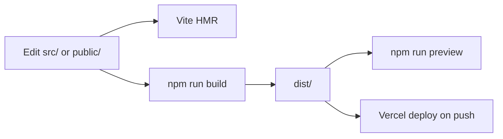

# Development

## Local Workflow

1. `npm install`
2. `npm run dev`
3. Edit TypeScript / CSS / assets; Vite HMR refreshes.
4. `npm run build` before pushing non-trivial changes.
5. Optionally `npm run preview` to smoke-test `dist/`.

---

## Project Conventions

| Area | Convention |
| --- | --- |
| Language | TypeScript, ESM, relative imports |
| UI | Vanilla DOM; factory functions returning controllers |
| CSS | BEM-ish `block__element--modifier` in `src/style.css` |
| Comments | Prefer no comments unless needed; docs live in `/docs` |
| Apps | Register in `types` + `registry`; one file per app |
| Git author | Commits as Lucas |

---

## Adding an App (Checklist)

1. Add PNG icon to `public/`.
2. Create `src/apps/<name>.ts` exporting an `AppDefinition`.
3. Extend `AppId` + `appOrder` in `types.ts`.
4. Import and register in `registry.ts`.
5. Style under `.app-*` in `style.css`.
6. If holding media/timers, implement `destroy` on the content root (see Music).
7. Document in `docs/apps/` and link from `docs/README.md` / apps overview.

---

## Changing Stage Art

Replace `public/loader.png` or `public/desktop.png` at **1920×1080**. If dimensions change, update CSS `.stage` size and design constants in `main.ts` / `desktop.ts` (`DESIGN_WIDTH` / `DESIGN_HEIGHT` and desktop `fit()`).

---

## Window and Icon Behavior to Preserve

- Icons: click-without-drag opens; drag snaps to 120×120 grid.
- Windows: single instance per `AppId`; reopen focuses or restores minimized.
- Shutdown: `closeAll()` then login restore - audio must stop via Music `destroy`.
- Pointer math must divide by current scale factors.

---

## Testing

There is **no automated test suite** in the repository. Manual checklist:

- [ ] Login clock updates
- [ ] Enter yeet → desktop
- [ ] Each app opens
- [ ] Window drag / minimize / close
- [ ] Music play + close stops audio
- [ ] Shut off returns to login and re-enter works
- [ ] Resize updates scale; warning appears below 1280×720
- [ ] Favicon shows in the tab
- [ ] `npm run build` succeeds

---

## Related Documents

- [Contributing](./contributing.md)
- [Configuration](./configuration.md)
- [Troubleshooting](./troubleshooting.md)
- [Apps Overview](./apps/overview.md)
