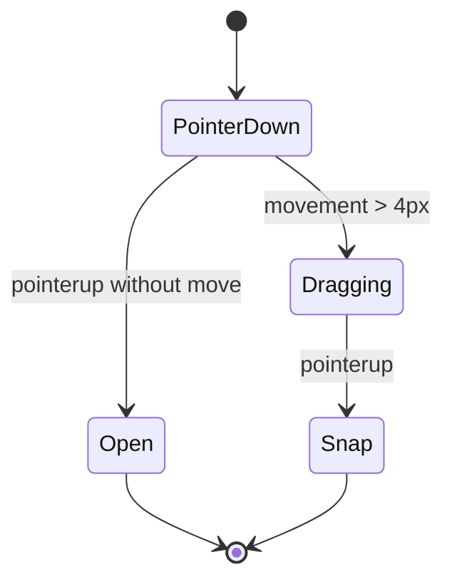

# Module: `desktopIcons.ts`

**Path:** `src/desktopIcons.ts`  
**Role:** Place desktop icons on an invisible grid, support drag-to-reposition, and open apps on click-without-drag.

---

## Purpose

Separate icon interaction from desktop chrome assembly. `desktop.ts` creates buttons; this module makes them behave like OS icons.

---

## Constants

| Name | Value | Meaning |
| --- | --- | --- |
| `GRID_X` / `GRID_Y` | 120 | Snap cell size in design pixels |
| `ICON_W` / `ICON_H` | 104 / 108 | Assumed icon hit box for clamping |
| `PAD` | 10 | Inset from workarea origin |

---

## API

```ts
export function enableIconDesktop(
  iconsMount: HTMLElement,
  buttons: HTMLButtonElement[],
  options: {
    workarea: HTMLElement;
    getScale: () => { x: number; y: number };
    onOpen: (id: AppId) => void;
  },
): void
```

Initial layout: column `0`, row `index` (vertical stack on the left).

---

## Drag vs Open Discrimination



- Movement threshold: 4 design pixels.
- On snap: round to nearest cell, clamp to workarea, store in `positions` map.
- Synthetic `click` is prevented/stopped so it does not double-fire opens.

---

## Coordinate Math

Pointer position is converted relative to the workarea bounding rect and divided by scale (see [Scaling and Viewport](../scaling-and-viewport.md)).

During drag, left/top are clamped so the icon stays inside the workarea. After release, cell clamp uses `maxCol`/`maxRow` from workarea client size.

---

## Edge Cases

| Case | Behavior |
| --- | --- |
| Non-primary button | Ignored on pointerdown |
| Overlapping icons | Allowed - no collision resolution |
| Tiny workarea | `maxCol`/`maxRow` can be 0 - all icons stack/clamp to origin cells |
| `releasePointerCapture` throws | Swallowed |

---

## Limitations

- Positions are in-memory only (lost on reload).
- No keyboard icon navigation.
- Does not reflow on resize (icons may sit outside new bounds until dragged).

---

## Related Documents

- [Module: desktop](./desktop.md)
- [Workflow: desktop session](../workflows/desktop-session.md)
