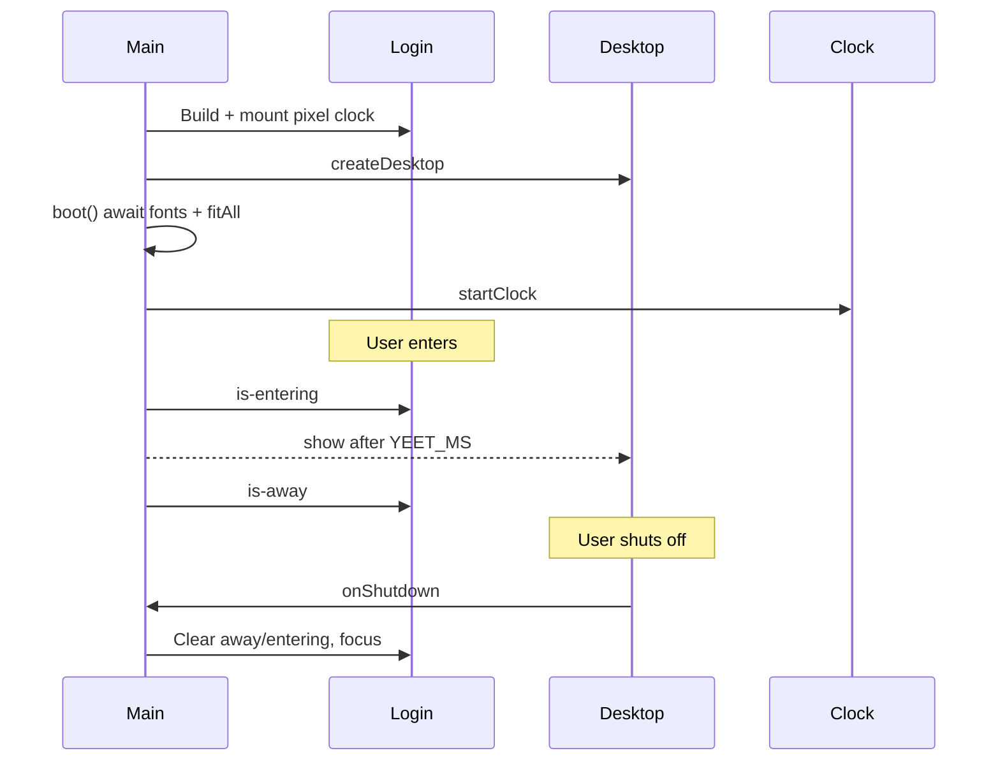

# Module: `main.ts`

**Path:** `src/main.ts`  
**Role:** Application entry point - boots login, wires desktop and resolution warning, owns the enter animation and global clock loop.

---

## Purpose

`main.ts` is the only module imported from `index.html`. It:

1. Imports global CSS.
2. Builds the login viewport DOM.
3. Constructs desktop and resolution-warning controllers.
4. Fits stages to the viewport.
5. Starts the shared 1 Hz clock.
6. Handles enter (yeet) and coordinates shutdown return to login.

---

## Responsibilities

| Responsibility | Details |
| --- | --- |
| Mount login | Injects markup into `#app` |
| Pixel clock | Creates and mounts `createPixelClock()` |
| Desktop lifecycle | `createDesktop({ onShutdown })` |
| Resolution banner | `createResolutionWarning()` + `sync` on resize |
| Enter gate | `entered` flag prevents double-enter |
| Clock routing | Login clock only while not `.is-away`; always `desktop.tick` |

---

## Key Constants

| Name | Value | Meaning |
| --- | --- | --- |
| `DESIGN_WIDTH` | 1920 | Login scale denominator |
| `DESIGN_HEIGHT` | 1080 | Login scale denominator |
| `YEET_MS` | 1350 | Delay before showing desktop after enter |

---

## Inputs / Outputs

**Inputs:** User click / Enter / Space on login; window resize; `beforeunload`.

**Outputs:** Mutates DOM classes on login/desktop; focuses login on shutdown return.

**Throws:** If `#app` is missing at boot.

---

## Lifecycle



---

## Internal Logic Highlights

### `enter()`

- No-ops if `entered` is already true.
- Sets `aria-disabled` and `.is-entering` (CSS yeet).
- After `YEET_MS`, calls `desktop.show()` and marks login `.is-away` + `aria-hidden`.

### `onShutdown` callback

Resets `entered`, removes entering/away classes, restores accessibility attributes, focuses login, and `fitLogin()`.

### Clock tick

```ts
if (!login.classList.contains("is-away")) {
  renderLoginClock(now);
}
desktop.tick(now);
```

Desktop `tick` itself no-ops when not visible.

### Cleanup

`beforeunload` calls `stopClock()` to clear the interval.

---

## Dependencies

- `./style.css`
- `./clock` - `formatClock`, `startClock`
- `./pixelClock` - `createPixelClock`
- `./desktop` - `createDesktop`
- `./resolutionWarning` - `createResolutionWarning`

---

## Edge Cases

| Case | Behavior |
| --- | --- |
| Spam click during yeet | Ignored (`entered` true) |
| Resize during login | `fitAll` refits login + desktop + warning |
| Fonts slow | `boot` awaits `document.fonts.ready` when available |
| Shutdown while Music playing | Desktop `closeAll` runs before hide (via desktop module) |

---

## Limitations

- Yeet duration is a hard-coded timeout, not synchronized to `animationend`.
- Login markup is a template string in JS, not a separate HTML partial.

---

## Related Documents

- [Workflow: boot and login](../workflows/boot-and-login.md)
- [Module: desktop](./desktop.md)
- [Module: clock](./clock.md)
