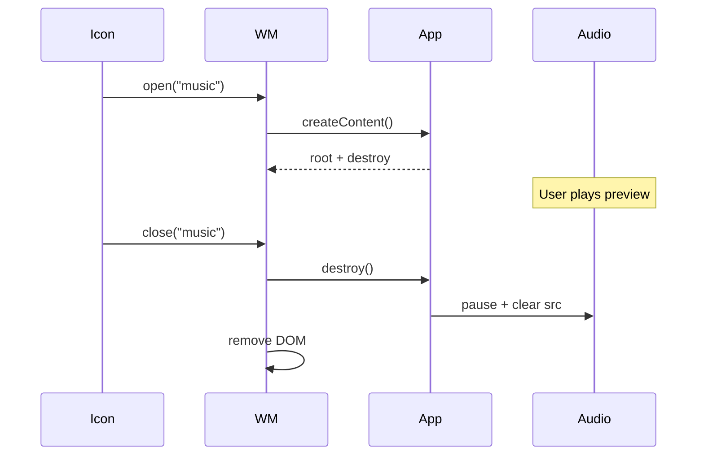

# Module: Window Manager

**Path:** `src/wm/windowManager.ts`  
**Role:** Create, focus, drag, minimize, restore, and close application windows.

---

## Purpose

Provide OS-like window chrome without a framework. Apps only supply content via `AppDefinition.createContent()`; this module owns chrome, stacking, and lifecycle teardown.

---

## Public API

```ts
export type WindowManager = {
  open: (id: AppId) => void;
  close: (id: AppId) => void;
  closeAll: () => void;
  minimize: (id: AppId) => void;
  restore: (id: AppId) => void;
  focus: (id: AppId) => void;
};

export function createWindowManager(
  layer: HTMLElement,
  getScale: ScaleProvider,
): WindowManager;
```

---

## Window Record

```ts
type WindowRecord = {
  id: AppId;
  el: HTMLElement;
  minimized: boolean;
};
```

Stored in a `Map<AppId, WindowRecord>` — **at most one window per app id**.

---

## Behaviors

### `open(id)`

- If exists and minimized → `restore`.
- If exists and visible → `focus`.
- Else create `<article class="os-window">` with titlebar (`_` minimize, `x` close) and body.
- Size from `app.width` / `app.height`.
- Cascaded position: `left = 180 + n*28`, `top = 120 + n*28` where `n = windows.size` at create time.
- Append `createContent()` into `[data-body]`.
- Enable titlebar drag; mousedown on window focuses.

### `focus(id)`

- No-op if missing or minimized.
- Increment `zCounter` (starts at 10), assign `z-index`.
- Toggle `.is-focused` among siblings.

### `minimize(id)`

- Sets `minimized`, adds `.is-minimized` (CSS `display: none`), removes focus class.

### `restore(id)`

- Clears minimized; focuses.

### `close(id)`

1. Query `[data-body] > *` as `DestroyableContent`.
2. Call optional `destroy()`.
3. Remove element; delete map entry.

### `closeAll()`

Closes every open id (snapshot of keys first).

---

## Destroy Hook

```ts
type DestroyableContent = HTMLElement & { destroy?: () => void };
```

Not part of `AppDefinition`. Music attaches `destroy` to stop audio. Other apps omit it.

**When it runs:** Close button and `closeAll` (shutdown).  
**When it does not run:** Minimize only.

---

## Dragging

`enableDrag(win, titlebar, getScale)`:

- Ignores pointerdown on buttons inside the titlebar.
- Uses pointer capture.
- Converts movement by `/ scale`.
- No bounds clamping — windows may leave the workarea.
- Adds `.is-dragging` during drag.

---

## Sequence: Open → Close



---

## Edge Cases

| Case | Behavior |
| --- | --- |
| Open same app twice | Focus/restore only — content not recreated |
| Focus while minimized | Focus no-ops until restore |
| Close unknown id | No-op |
| Missing destroy | Close still removes DOM |

---

## Limitations

- No resize, maximize, or snap tiling.
- No minimize restore UI besides re-clicking the icon.
- Title is plain `textContent` (not pixel canvas).
- z-counter never resets (fine for session length).

---

## Related Documents

- [Workflow: app lifecycle](../workflows/app-lifecycle.md)
- [Apps: Music](../apps/music.md)
- [Apps Overview](../apps/overview.md)
