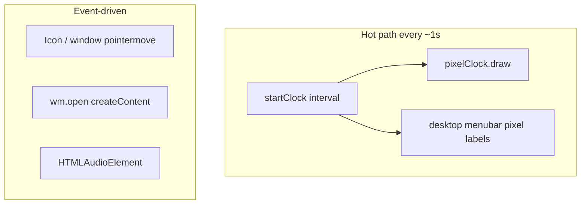

# Performance

XUANOS aims to feel instant on a modern laptop/desktop browser. There is no performance budget file or Lighthouse CI in the repo; this page documents what the code actually does and how to keep it fast.

---

## Runtime Profile

| Work | Frequency | Cost notes |
| --- | --- | --- |
| Clock tick | 1 Hz | Formats time; draws login canvas and/or menubar labels when visible |
| `fit` / resize | On resize | Sets CSS `transform: scale(...)` on stage scalers |
| Window drag | Pointer move | Style left/top updates; scale-corrected |
| App open | Per open | Builds DOM for that app once until closed |
| Music | On play | Network fetch + decode of remote AAC preview |

There is **no** requestAnimationFrame game loop for the OS chrome.

---

## Bundle and Build

- Production build: `tsc && vite build` → static assets in `dist/`.
- No framework runtime — only your modules + Vite’s ESM output.
- CSS is a single `src/style.css` imported from `main.ts`.

**Tips:**

- Avoid adding heavy UI libraries unless necessary.
- Prefer editing existing modules over new abstraction layers that increase parse cost.

---

## Assets

Largest cost is usually **PNG/JPG weight**, not TypeScript.

| Category | Examples | Guidance |
| --- | --- | --- |
| Stage art | `loader.png`, `desktop.png` | Keep 1920×1080; compress carefully |
| Icons / portraits | `*-icon.png`, `me-portrait.png` | Already sized for display; avoid multi-MB sources |
| Music art | `public/music/*.jpg` | Local covers; previews stream from Apple |
| Favicon | `favicon.png` | Small tab icon |

Vite copies `public/` as-is — it does not automatically recompress images.

---

## Canvas Text

- Login clock: low-res canvas (~¼ of clock box), then `crushToInk` for a stamped look.
- Menubar labels: higher-quality pixel labels with supersampling.
- Drawing runs on the 1s clock when the surface is visible; login draw is skipped when login has `.is-away`.

Avoid calling `draw` more often than needed (e.g. do not attach a 60 fps loop for static labels).

---

## Audio

- `Audio.preload = "none"` until play.
- Only one preview plays at a time; switching songs pauses and replaces `src`.
- `destroy()` on window close pauses and clears `src` so audio does not leak after shutdown.

Autoplay policies mean the first play must follow a user gesture (the play button click).

---

## Scaling Cost

Independent X/Y CSS scale on a 1920×1080 stage is cheap (compositor). Pointer math divides by scale factors so drag stays correct; that is O(1) per event.

Non-uniform stretch can look soft on odd aspect ratios — that is a design tradeoff, not a CPU issue. See [Scaling and Viewport](./scaling-and-viewport.md).

---

## Network

Cold load depends on:

1. HTML + JS + CSS from the origin.
2. Google Fonts CSS + font files.
3. Stage/icon images as they appear.
4. Optional iTunes preview when Music plays.

Fonts are render-blocking by design for canvas text alignment after `document.fonts.ready`.

---

## Measuring Locally

There is no project script for perf. Use browser DevTools:

- **Network** — asset sizes, Apple CDN failures.
- **Performance** — confirm no unexpected rAF storms.
- **Coverage / Lighthouse** — optional; not gated in CI.

---

## Related Documents

- [Assets](./assets.md)
- [Architecture](./architecture.md)
- [Troubleshooting](./troubleshooting.md)
