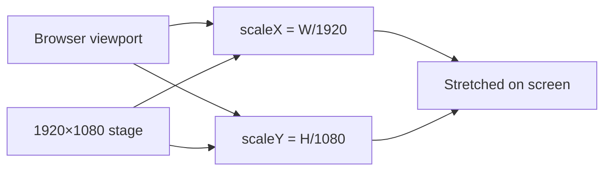

# Scaling and Viewport

## Design Canvas

XUANOS is authored against a fixed design size:

| Constant | Value | Location |
| --- | --- | --- |
| Design width | `1920` | `main.ts` (`DESIGN_WIDTH`), `desktop.ts` (`fit`) |
| Design height | `1080` | `main.ts` (`DESIGN_HEIGHT`), `desktop.ts` (`fit`) |

PNG stage art (`loader.png`, `desktop.png`) is authored at the same resolution and placed with `width="1920" height="1080"`.

---

## Stretch Scaling (Not Letterboxing)

Both login and desktop wrap content in `.stage-scaler` and apply:

```ts
scaleX = window.innerWidth / 1920
scaleY = window.innerHeight / 1080
scaler.style.transform = `scale(${scaleX}, ${scaleY})`
```

**Why:** The product decision is to fill the viewport completely. Side letterbox bars were rejected earlier in development.

**Consequence:** Non-16:9 viewports distort the drawing slightly. Icons and windows still use design-space coordinates; pointer math compensates.



---

## Transform Origin

| Surface | Origin | Why |
| --- | --- | --- |
| Generic `.stage-scaler` | `center center` | Default scale from center |
| Login `.stage` during yeet | `50% 57%` | Zoom toward the drawn clock box |
| Shutdown `.desktop__stage` | `2% 98%` | Collapse toward power button corner |

---

## Pointer Coordinate Conversion

Because CSS `transform: scale` affects visual size but not the layout coordinate system of the unscaled stage the same way users perceive motion, drag handlers convert client pixels to design pixels:

### Icons (`desktopIcons.ts`)

```ts
x = (clientX - workareaRect.left) / scale.x
y = (clientY - workareaRect.top) / scale.y
```

### Windows (`windowManager.ts`)

```ts
dx = (clientX - originX) / scale.x
dy = (clientY - originY) / scale.y
```

`getScale` is a callback so resize mid-drag still uses fresh factors (desktop stores `scaleX`/`scaleY` updated in `fit()`).

---

## Visibility and Display

| Class | Effect |
| --- | --- |
| `.viewport.is-away` | `display: none !important` — login after enter |
| `.desktop.is-active` | Desktop shown |
| `[hidden]` on viewport | Also forced hidden (defense in depth) |

**Edge case:** Do not rely on the HTML `hidden` attribute alone while an element also has `display: flex` from CSS. Prefer `.is-away` / `.is-active` toggles as the primary mechanism.

---

## Resolution Warning Threshold

| Constant | Value |
| --- | --- |
| `MIN_WIDTH` | 1280 |
| `MIN_HEIGHT` | 720 |

Below either dimension, `resolutionWarning.sync()` shows a dismissible banner. Dismissing sticks until the viewport returns to an acceptable size (then `dismissed` resets).

See [Module: resolution warning](./modules/resolution-warning.md).

---

## Workarea Bounds

Icons are constrained to `.desktop__workarea` using:

- Grid cell size `120×120`
- Icon size assumptions `ICON_W = 104`, `ICON_H = 108`
- Padding `PAD = 10`

Windows are **not** clamped to the workarea during drag.

---

## Limitations

- Extreme ultrawide or tall phones heavily stretch artwork.
- Fractional device pixel ratios can soften pixel text slightly despite `image-rendering: pixelated`.
- Changing design size requires coordinated updates to constants, CSS stage size, and PNG assets.

---

## Related Documents

- [Architecture](./architecture.md)
- [Module: main](./modules/main.md)
- [Module: desktop](./modules/desktop.md)
- [Module: desktop icons](./modules/desktop-icons.md)
