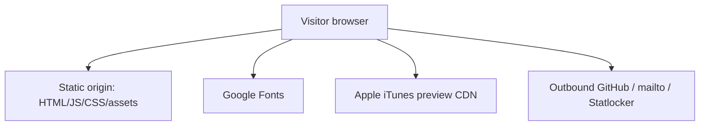

# Security

XUANOS is a **static, client-only** portfolio. There is no server application, authentication, session store, or privileged API in this repository. Security work here means reducing browser-side risk and being honest about the threat model.

---

## Threat Model (What Exists)

| Asset | Sensitivity | Notes |
| --- | --- | --- |
| Source in `src/` | Public | Shipped to every visitor |
| Images in `public/` | Public | Same |
| Contact email in Me app | Public by design | `lucaszhangbusiness@gmail.com` |
| iTunes preview URLs | Public | Third-party media |
| GitHub profile / repo links | Public | Open in new tabs |

There are **no** secrets, API keys, `.env` files, or auth tokens expected in the tree.

---

## What Is Explicitly Out of Scope

- User accounts, passwords, OAuth, cookies for identity.
- Server-side input validation (no backend).
- CSRF / SSRF against an app server (none).
- SQL / NoSQL injection (no database).
- Privilege escalation inside a fictional OS (metaphor only).

Do not invent backend security controls in docs or code unless a real backend is added.

---

## Client-Side Practices in the Codebase

| Practice | Where | Why |
| --- | --- | --- |
| `rel="noopener noreferrer"` on `target="_blank"` | Desktop GitHub, Me, Projects, Deadlock | Avoids `window.opener` tabnabbing |
| `mailto:` only for email | Me app | No custom form POST |
| No `eval` / dynamic `Function` | Entire `src/` | Keeps XSS surface smaller |
| No `innerHTML` of untrusted remote JSON | Apps use hardcoded content | Portfolio data is authored in source |
| Music uses fixed HTTPS preview URLs | `music.ts` | No user-supplied audio URLs |

### XSS note

Several apps build markup with template strings and `innerHTML` from **author-controlled** constants (project names, blurbs, course lists). That is acceptable while content stays in-repo. If content ever becomes user-generated or CMS-fed, switch to `textContent` / safe DOM APIs or sanitize.

---

## Third-Party Dependencies

| Dependency | Role | Trust notes |
| --- | --- | --- |
| Vite / TypeScript (dev) | Build only | Not shipped as app runtime packages |
| Google Fonts | Typography | Network dependency; privacy/CDN availability |
| Apple iTunes CDN | Music previews | Network dependency; URLs can rot |
| Statlocker / GitHub | External links | User navigates away |

Supply-chain risk is limited to **devDependencies** at build time. Keep `package-lock.json` and prefer `npm ci` in CI if CI is added later.

---

## Hosting Considerations (Vercel / static hosts)

- Serve only the `dist/` output (or equivalent).
- Prefer HTTPS (Vercel default).
- `vercel.json` rewrites all routes to `/index.html` — fine for this SPA shell; there is no authenticated route to protect.
- Do not upload secrets into the repo or Vercel env vars unless a future feature needs them (none today).

---

## Reporting Issues

If you find a client-side issue (e.g. unexpected script injection path), open a GitHub issue or PR on [LucasZhang3/pf](https://github.com/LucasZhang3/pf). There is no separate security bounty program.

---

## Related Documents

- [System Overview](./system-overview.md) — non-goals
- [Configuration](./configuration.md)
- [FAQ](./faq.md)
