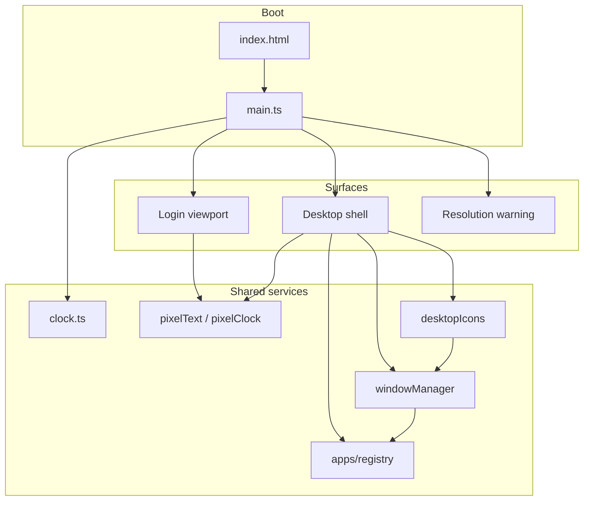

# System Overview

## What Is XUANOS?

**XUANOS** is a personal portfolio presented as a fictional desktop operating system. Visitors do not browse a conventional multi-page website. They "log in," land on a hand-drawn desktop, open apps in windows, and can shut the machine off to return to the login screen.

The project lives at [https://github.com/LucasZhang3/pf](https://github.com/LucasZhang3/pf). The npm package name is `xuanos` (`package.json`), version `0.1.0`, marked `private`.

---

## Purpose

| Goal | How XUANOS addresses it |
| --- | --- |
| Show who Lucas is | Me, School, Comps, Projects apps |
| Show personality | Hand-drawn art, casual copy, Deadlock and Music apps |
| Feel memorable | OS metaphor, yeet login, bad shutdown animation |
| Stay lean and fast | Vite + TypeScript, no React/framework runtime |
| Match a drawn aesthetic | PNG stage art + pixelated canvas text |

---

## Who It Is For

- **Visitors** exploring the portfolio as an interactive artifact.
- **Recruiters / peers** who want projects, school, and contact info without a sterile resume layout.
- **Contributors** extending apps, chrome, or visual polish.

---

## Core Features

### Login stage

- Full-bleed hand-drawn `loader.png` (1920×1080 design canvas).
- Live weekday / date / time rendered as low-resolution canvas text inside a drawn box.
- Click, Enter, or Space triggers a spin-zoom "yeet" into the white clock box, then reveals the desktop.

### Desktop shell

- Hand-drawn `desktop.png` background with top and bottom menubar chrome.
- Top-left brand label **XUANOS** (pixel canvas).
- Top-right live clock + GitHub link to this repository.
- Bottom-left power button → **shut off** → shutdown animation → back to login.
- Bottom-right signature **乐轩2026** (ZCOOL KuaiLe).
- Draggable desktop icons on an invisible 120×120 grid.
- Stacked, focusable, draggable app windows (no resize).

### Apps

| App ID | Window title | Role |
| --- | --- | --- |
| `me` | Me | Portrait, quote, GitHub + email |
| `projects` | Projects | Expandable project list with GitHub links |
| `programming-comps` | Comps | Competition stats and goals |
| `school` | School | GPA, APs, extracurriculars |
| `music` | Music | Favorite artists/songs + iTunes preview playback |
| `deadlock` | Deadlock | Character slides + rank / Statlocker link |

### Cross-cutting

- Resolution warning when viewport is below 1280×720.
- Scrollbars hidden globally; overflow scrolling still works where needed.
- Favicon: rainbow flower PNG (`public/favicon.png`).

---

## Non-Goals (Explicit)

XUANOS intentionally does **not** include:

- A backend, database, or user accounts.
- Real OS process isolation, multitasking scheduler, or filesystem.
- Window resize, maximize, or a taskbar restore UI for minimized windows (minimize hides the window; reopen via icon restores/focuses).
- Automated unit/e2e test suite (none in repo).
- i18n / localization framework.
- Dark mode or theme switcher.
- Service workers / offline PWA support.
- Persistence of icon positions or open windows across reloads.

---

## Technology Stack

| Layer | Choice | Why |
| --- | --- | --- |
| Bundler / dev server | Vite 8 | Fast HMR, static asset serving from `public/` |
| Language | TypeScript ~6 | Typed DOM code, `tsc` as typecheck gate |
| UI | Vanilla DOM | No framework cost; matches lean goal |
| Styling | Single `style.css` | Hand-tuned CSS, no Tailwind |
| Fonts | Gochi Hand, ZCOOL KuaiLe (Google Fonts) | Scribble / playful look |
| Audio | HTML `Audio` element | Music app iTunes preview URLs |

Runtime dependencies: **none** (only `typescript` and `vite` as `devDependencies`).

---

## High-Level Architecture

For deeper diagrams and module contracts, see [Architecture](./architecture.md).

---

## Execution Model

1. Browser loads `index.html`, pulls fonts, starts `/src/main.ts`.
2. `main.ts` injects the login markup, creates desktop and resolution warning controllers, waits for fonts, fits the stage to the viewport.
3. A 1-second clock interval updates login (if visible) and desktop chrome.
4. User enters → yeet animation (~1350 ms) → desktop `show()`.
5. Icons open apps through the window manager; Music may attach optional `destroy()` for audio cleanup.
6. Shut off closes all windows (stopping music), animates shutdown (~1400 ms), hides desktop, restores login.

---

## Design Canvas Assumption

All interactive chrome is authored against a **1920×1080** stage. The stage is **stretched** independently on X and Y to fill the viewport (not letterboxed). Pointer math divides by current scale factors so drag feels correct under non-uniform scaling.

See [Scaling and Viewport](./scaling-and-viewport.md).

---

## Limitations Summary

- Best experienced at ≥1280×720; smaller viewports get a dismissible warning and a distorted stretch.
- Minimized windows are not listed in a dock; the only restore path is clicking the same icon again.
- Windows can be dragged outside the workarea (no hard clamp on window drag).
- Music previews depend on Apple CDN availability and browser autoplay policies.
- Icon grid positions reset on full page reload.

---

## Related Documents

- [Architecture](./architecture.md)
- [Design Philosophy](./design-philosophy.md)
- [Installation](./installation.md)
- [Apps Overview](./apps/overview.md)
