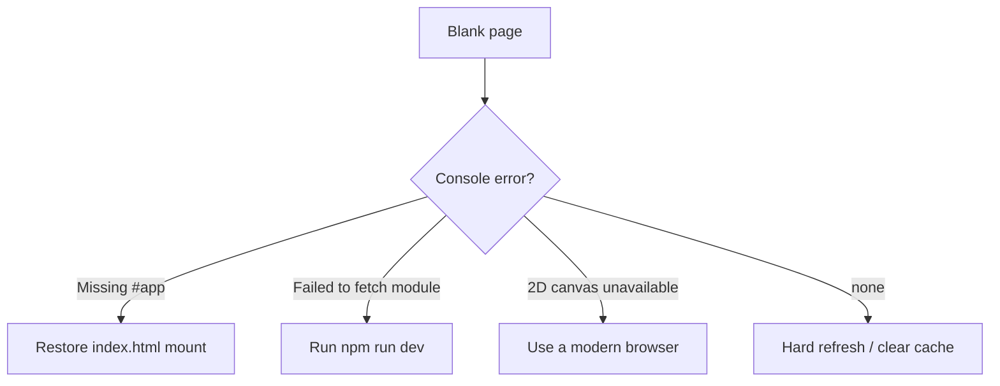

# Troubleshooting

Practical fixes for failures that show up when developing or hosting XUANOS. All guidance maps to behavior in the current codebase.

---

## Table of Contents

1. [Install and toolchain](#install-and-toolchain)
2. [Dev server and blank screen](#dev-server-and-blank-screen)
3. [Login and enter](#login-and-enter)
4. [Desktop and windows](#desktop-and-windows)
5. [Music playback](#music-playback)
6. [Build and deploy](#build-and-deploy)
7. [Visual / scaling issues](#visual--scaling-issues)
8. [Diagnostics checklist](#diagnostics-checklist)

---

## Install and toolchain

| Symptom | Likely cause | Fix |
| --- | --- | --- |
| `npm install` fails | Old Node / network | Use a current Node LTS; retry; clear `node_modules` + lock if corrupted |
| `tsc` errors on unused locals | Strict `tsconfig` | Remove unused symbols or use them; options are intentional |
| Vite not found | Deps not installed | Run `npm install` from repo root |

There is no project-specific CLI beyond the three npm scripts in `package.json`.

---

## Dev server and blank screen

| Symptom | Likely cause | Fix |
| --- | --- | --- |
| White / empty page | JS threw before paint | Open DevTools console; look for `Missing #app root` or canvas errors |
| `Missing #app root` | `index.html` mount removed | Restore `

` |
| Module 404 for `/src/main.ts` | Not running via Vite | Use `npm run dev`, not opening `index.html` as a file URL |
| Fonts look wrong | Google Fonts blocked | Check network; fonts are loaded from Google; canvas falls back to `cursive` |

---

## Login and enter

| Symptom | Likely cause | Fix |
| --- | --- | --- |
| No clock text | Canvas / fonts | Wait for `document.fonts.ready`; check `.stage__clock` size |
| Click does nothing | Already entered / aria state | Reload; ensure `entered` was reset via shutdown path |
| Stuck mid-yeet | Tab backgrounded / timer delay | Wait ~1350 ms (`YEET_MS`); reload if CSS interrupted |
| Keyboard ignore | Focus not on login | Click the login surface first, then Enter/Space |

Double-enter is intentionally ignored (`if (entered) return`).

---

## Desktop and windows

| Symptom | Likely cause | Fix |
| --- | --- | --- |
| Icons missing | Registry / assets | Confirm `listApps()` and `/…-icon.png` paths under `public/` |
| Click opens wrong app | `data-app-id` mismatch | Icon `dataset.appId` must match `AppId` |
| Drag feels wrong | Scale math | Pointer deltas are divided by `scaleX`/`scaleY`; check `fit()` |
| Minimize “lost” window | No dock UI | Click the same desktop icon again to restore/focus |
| Music keeps playing after close | Missing `destroy` | Music implements `destroy`; other apps do not need it unless they hold resources |

Window resize and maximize are **not implemented**.

---

## Music playback

| Symptom | Likely cause | Fix |
| --- | --- | --- |
| Play button does nothing | Autoplay / network | Click play after a user gesture; check Apple CDN in Network tab |
| Preview 404 | Stale iTunes URL | Update `preview` URL in `src/apps/music.ts` |
| Volume slider unused | Audio not started | Slider sets `audio.volume`; play a song first |
| Audio after shut off | Window not closed | Shutdown calls `wm.closeAll()`, which runs Music `destroy` |

Previews are remote `.m4a` URLs on `audio-ssl.itunes.apple.com`, not files in `public/`.

---

## Build and deploy

| Symptom | Likely cause | Fix |
| --- | --- | --- |
| `npm run build` fails at `tsc` | Type errors | Fix TypeScript; `tsc` runs with `noEmit: true` before Vite |
| Assets 404 in production | Wrong base path | Host with root `/`; Vite copies `public/` to `dist/` root |
| SPA deep links 404 | Host lacks rewrite | Vercel uses `vercel.json` rewrite to `/index.html`; other hosts need equivalent |
| Favicon missing | Link or file absent | Ensure `public/favicon.png` + `<link rel="icon" … href="/favicon.png" />` |

Production URL for this project: [https://lexuan.vercel.app](https://lexuan.vercel.app).

---

## Visual / scaling issues

| Symptom | Likely cause | Fix |
| --- | --- | --- |
| Stretched / squashed art | Non-uniform scale | By design: stage uses independent X/Y scale to fill viewport |
| Warning banner | Viewport &lt; 1280×720 | Enlarge window or dismiss (`resolutionWarning.ts`) |
| Pixel text blurry | Browser scaling / DPR | Pixel labels use canvas crush; hi-res menubar uses supersample |
| Stage art wrong size | Replaced PNG | Keep login/desktop art at **1920×1080** |

---

## Diagnostics checklist

1. `npm install` and `npm run build` succeed locally.
2. Console clean on cold load.
3. Login clock ticks every second.
4. Enter → desktop within ~1.4 s.
5. Each of the six apps opens once.
6. Music play → pause → close stops audio.
7. Shut off returns to login; enter works again.
8. Resize triggers scale update; warning appears below 1280×720.

---

## Related Documents

- [Installation](./installation.md)
- [Configuration](./configuration.md)
- [FAQ](./faq.md)
- [Performance](./performance.md)
