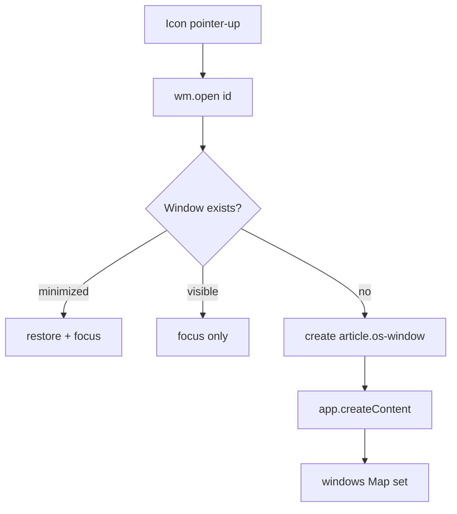

# Workflow: App Lifecycle

## Goal

Trace an app from desktop icon to window close, including focus, minimize, and cleanup.

---

## Open Path

Cascading position: `left = 180 + size*28`, `top = 120 + size*28` (design pixels). Size from `AppDefinition.width/height`.

---

## Focus

- mousedown on window → `focus(id)`
- Increments `zCounter`, sets `z-index`, toggles `.is-focused` among siblings

---

## Minimize / Restore

- Minimize: `minimized=true`, `.is-minimized`, lose focus class
- Restore: only via `open` when record exists and was minimized (icon click)
- **No** taskbar or dock UI

---

## Close

1. Query `[data-body] > *` for optional `destroy()`
2. Remove element
3. Delete map entry

`closeAll` iterates ids and closes each (used on shutdown).

---

## Single Instance Rule

One window per `AppId`. Reopening never spawns a second Me/Projects/etc.

---

## Related Documents

- [Window Manager](../modules/window-manager.md)
- [Apps Overview](../apps/overview.md)
- [Desktop session](./desktop-session.md)
