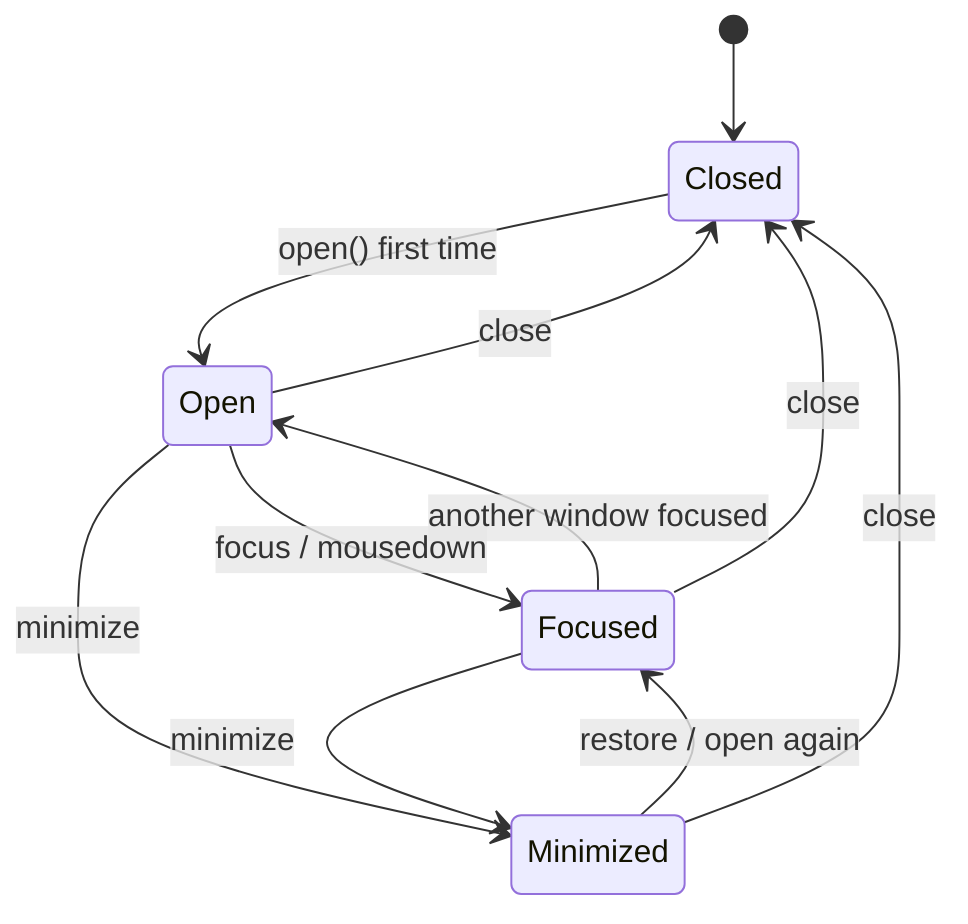

# Workflow: App Lifecycle

## States

Note: “Open” vs “Focused” are both mounted; only one window has `.is-focused` among visible windows.

---

## Create

`createContent()` runs once per open-from-closed. Closing destroys the DOM; the next open creates fresh content (Deadlock resets to slide 1, Music gets a new `Audio`).

---

## Minimize vs Close

| Action | DOM | App state | Audio (Music) |
| --- | --- | --- | --- |
| Minimize | Hidden via CSS | Preserved in memory | Keeps playing |
| Close | Removed | Discarded | Stopped via `destroy` |
| Shutdown | All closed | Discarded | Stopped |

---

## Restore Path

There is no dock. Clicking the desktop icon calls `open`, which restores minimized windows or focuses existing ones.

---

## Related Documents

- [Window Manager](../modules/window-manager.md)
- [Apps Overview](../apps/overview.md)
