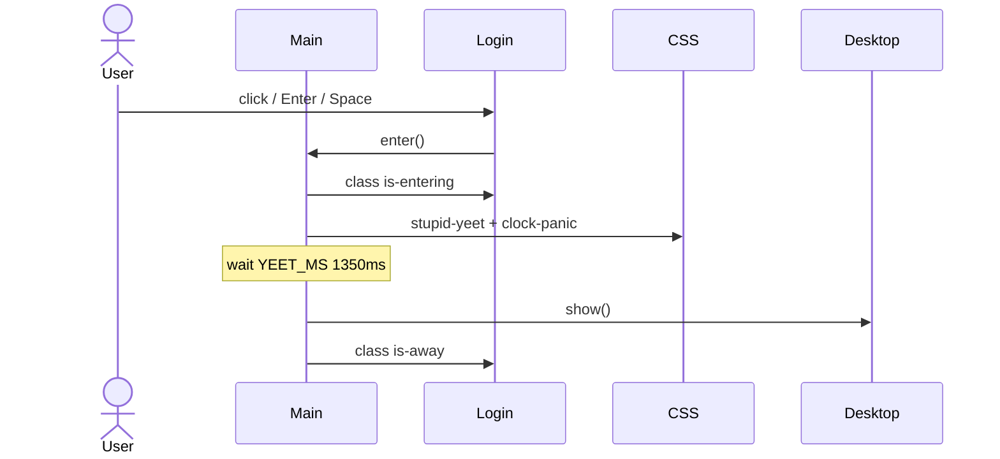

# Workflow: Boot and Login

## Goal

Cold-load the page, show the hand-drawn login with a live clock, and transition into the desktop when the user enters.

---

## Actors and Files

| Piece | Role |
| --- | --- |
| `index.html` | Fonts, favicon, `#app`, module entry |
| `main.ts` | Login markup, enter, clock wiring, shutdown callback |
| `pixelClock.ts` | Canvas clock in the drawn box |
| `clock.ts` | `formatClock` + 1s `startClock` |
| `style.css` | `.login.is-entering`, `stupid-yeet`, `clock-panic` |

---

## Steps

1. Browser loads `index.html` (fonts, favicon, `#app`).
2. Vite serves `/src/main.ts`; CSS imported.
3. Login markup injected into `#app`; pixel clock canvas mounted under `.stage__clock`.
4. `createDesktop({ onShutdown })` and `createResolutionWarning()` appended (desktop `aria-hidden` until shown).
5. `boot()` awaits `document.fonts.ready` when present, then `fitAll()`.
6. `startClock` begins; login clock updates while login is not `.is-away`; `desktop.tick` no-ops while hidden.
7. User clicks login or presses Enter/Space → `enter()`.
8. `.is-entering` starts yeet CSS (~spin/zoom into clock box).
9. After **1350 ms** (`YEET_MS`), `desktop.show()`, login gets `.is-away` + `aria-hidden`.



---

## Fit Math

```ts
scaleX = innerWidth / 1920
scaleY = innerHeight / 1080
loginScaler.style.transform = `scale(${scaleX}, ${scaleY})`
```

Resize listener calls `fitAll()` → login fit + `desktop.fit()` + `resolutionWarning.sync()`.

---

## Assumptions

- `#app` exists or boot throws.
- `loader.png` ideally loads (broken image still allows interaction).
- User gesture not required for clock drawing (only later for audio).

---

## Edge Cases

| Case | Outcome |
| --- | --- |
| Double enter | Second ignored (`entered` flag) |
| Resize mid-yeet | `fitAll` still runs; animation continues |
| Prefers-reduced-motion | Not specially handled - animation still runs |
| Shutdown then re-enter | `onShutdown` clears `entered` and login classes |

---

## Related Documents

- [Module: main](../modules/main.md)
- [Desktop session](./desktop-session.md)
- [Scaling and Viewport](../scaling-and-viewport.md)
