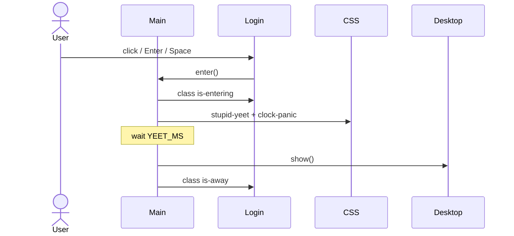

# Workflow: Boot and Login

## Goal

Cold-load the page, show the hand-drawn login with a live clock, and transition into the desktop when the user enters.

---

## Steps

1. Browser loads `index.html` (fonts, favicon, `#app`).
2. Vite serves `/src/main.ts`.
3. CSS imported; login markup injected; pixel clock mounted.
4. Desktop and resolution warning created and appended (desktop hidden).
5. `boot()` awaits `document.fonts.ready` when present, then `fitAll()`.
6. `startClock` begins; login clock + desktop tick (desktop no-ops while hidden).
7. User clicks login or presses Enter/Space → `enter()`.
8. `.is-entering` starts yeet CSS (~spin/zoom into clock box).
9. After 1350 ms, `desktop.show()`, login gets `.is-away`.

---

## Assumptions

- `#app` exists.
- `loader.png` loads (broken image still allows interaction).
- User gesture not required for clock drawing (only for later audio).

---

## Edge Cases

| Case | Outcome |
| --- | --- |
| Double enter | Second ignored |
| Resize mid-yeet | `fitAll` still runs; animation continues |
| Prefers-reduced-motion | Not specially handled — animation still runs |

---

## Related Documents

- [Module: main](../modules/main.md)
- [Desktop session](./desktop-session.md)
