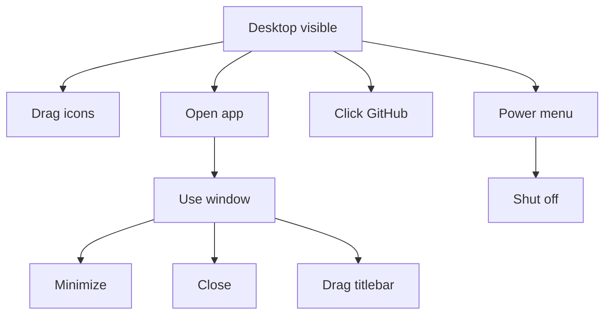

# Workflow: Desktop Session

## Goal

Describe steady-state use after login: chrome updates, icons, windows, and external links.

---

## Active Systems

| System | Behavior while desktop visible |
| --- | --- |
| Clock tick | Redraws brand, time, signature canvases |
| Icons | Drag/snap/open |
| Window manager | Open/focus/minimize/close/drag |
| Power menu | Toggle / outside click dismiss |
| Resolution warning | Independent overlay; still syncs on resize |

---

## Typical User Paths

### Opening apps

Icon `pointerup` without drag → `wm.open(id)`.

### Focusing

Mousedown on a window raises z-index and `.is-focused`.

### Menubar GitHub

Opens the pf repository in a new tab; does not affect OS state.

---

## State That Exists Only in Memory

- Icon grid positions.
- Open/minimized windows and z-order.
- Music playback position (if Music open).
- Deadlock slide index.
- Which project/school panels are expanded.

Reload discards all of the above.

---

## Related Documents

- [Module: desktop](../modules/desktop.md)
- [App lifecycle](./app-lifecycle.md)
- [Shutdown](./shutdown.md)
