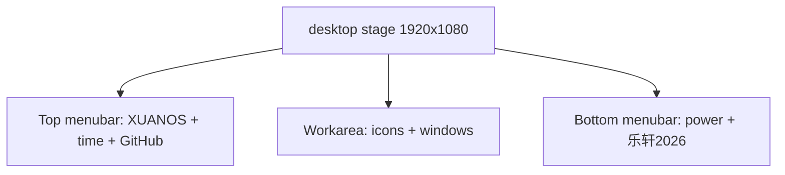

# Workflow: Desktop Session

## Goal

Describe steady-state use after login: menubar chrome, icons, windows, and power menu — before shutdown.

---

## Layout

| Region | Contents |
| --- | --- |
| Top left | Pixel label **XUANOS** |
| Top right | Live time (pixel) + GitHub link to `LucasZhang3/pf` |
| Workarea | Icon column + window layer |
| Bottom left | Power button → **shut off** |
| Bottom right | Signature **乐轩2026** (ZCOOL KuaiLe) |

---

## Icon Interaction

From `desktopIcons.ts`:

1. Icons start in column 0, rows 0…n−1 (`appOrder`).
2. Pointer down begins potential drag; movement &gt; 4px marks `moved`.
3. Pointer up without move → `onOpen(id)` → `wm.open(id)`.
4. Drag snaps to 120×120 grid, clamped to workarea.

Native `click` on icons is swallowed so open only happens via the pointer-up path (avoids double-open).

---

## Window Interaction

| Action | Behavior |
| --- | --- |
| Open | Create window at cascading offset, or focus/restore existing |
| Drag | Titlebar pointer capture; deltas ÷ scale |
| Minimize | `.is-minimized`; no dock |
| Close | Optional `destroy()`, remove DOM, drop map entry |
| Focus | Raise z-index, `.is-focused` |

See [App Lifecycle](./app-lifecycle.md) and [Window Manager](../modules/window-manager.md).

---

## Clock While Visible

`main.ts` clock interval calls `desktop.tick(now)` when desktop is visible → repaints brand, time, signature pixel labels.

---

## Power Menu

- Toggle via power button (`aria-expanded`).
- Click outside closes menu.
- **shut off** starts [Shutdown](./shutdown.md).

---

## Related Documents

- [Module: desktop](../modules/desktop.md)
- [Module: desktop-icons](../modules/desktop-icons.md)
- [Boot and Login](./boot-and-login.md)
