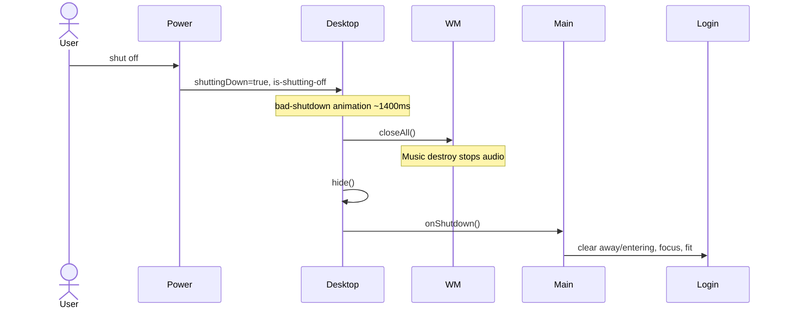

# Workflow: Shutdown

## Goal

Return from desktop to login with a theatrical “bad shutdown,” without leaving audio or windows behind.

---

## Trigger

Bottom-left power button → menu → **shut off**.

---

## Sequence

---

## Guarantees

- `closeAll` runs **before** hide so content `destroy` hooks execute while nodes still exist as expected.
- `shuttingDown` prevents stacked timeouts from double-clicking shut off.
- `entered` reset allows logging in again.

---

## What Is Not Persisted

After shutdown (and after reload), icon positions and window state are gone. Shutdown does not write to `localStorage`.

---

## Related Documents

- [Module: desktop](../modules/desktop.md)
- [Apps: Music](../apps/music.md)
- [Boot and login](./boot-and-login.md)
