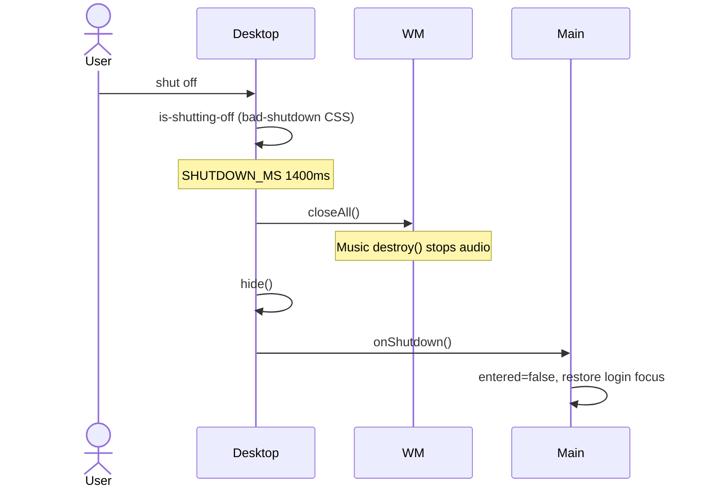

# Workflow: Shutdown

## Goal

Return from an active desktop session to the login screen, closing apps and stopping media.

---

## Trigger

User opens the power menu and clicks **shut off** (`data-shutdown`).

---

## Sequence

Constants: `SHUTDOWN_MS = 1400` in `desktop.ts`. Animation: `bad-shutdown` on `.desktop.is-shutting-off .desktop__stage`.

---

## `onShutdown` (main.ts)

- `desktop.hide()` already invoked from desktop path; callback also:
  - Sets `entered = false`
  - Removes login `is-entering` / `is-away`
  - Restores login `aria-*` and focus
  - `fitLogin()`

Double shut-off while animating is ignored (`shuttingDown` flag).

---

## Guarantees

| Concern | Result |
| --- | --- |
| Open windows | Removed via `closeAll` |
| Music audio | Stopped if Music implemented `destroy` |
| Icon positions | Kept in memory until full page reload |
| Login clock | Resumes (login no longer `.is-away`) |

---

## Related Documents

- [Desktop session](./desktop-session.md)
- [Module: desktop](../modules/desktop.md)
- [App: Music](../apps/music.md)
